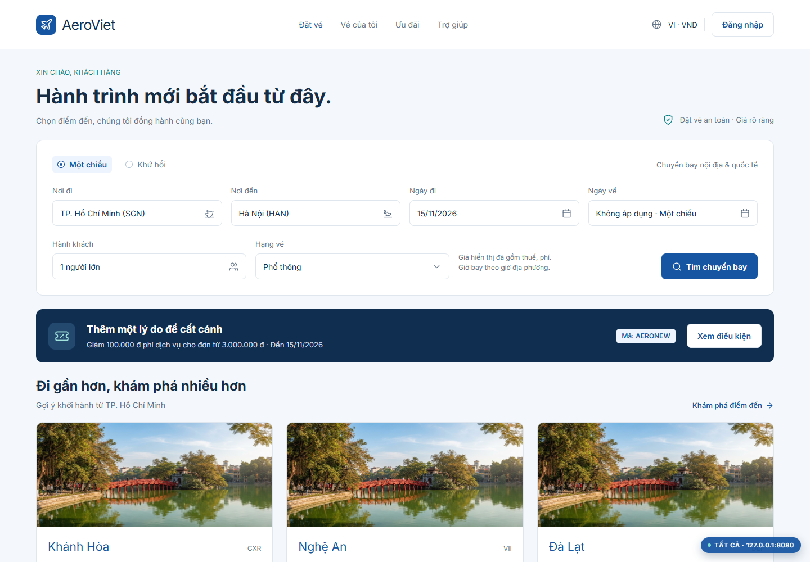
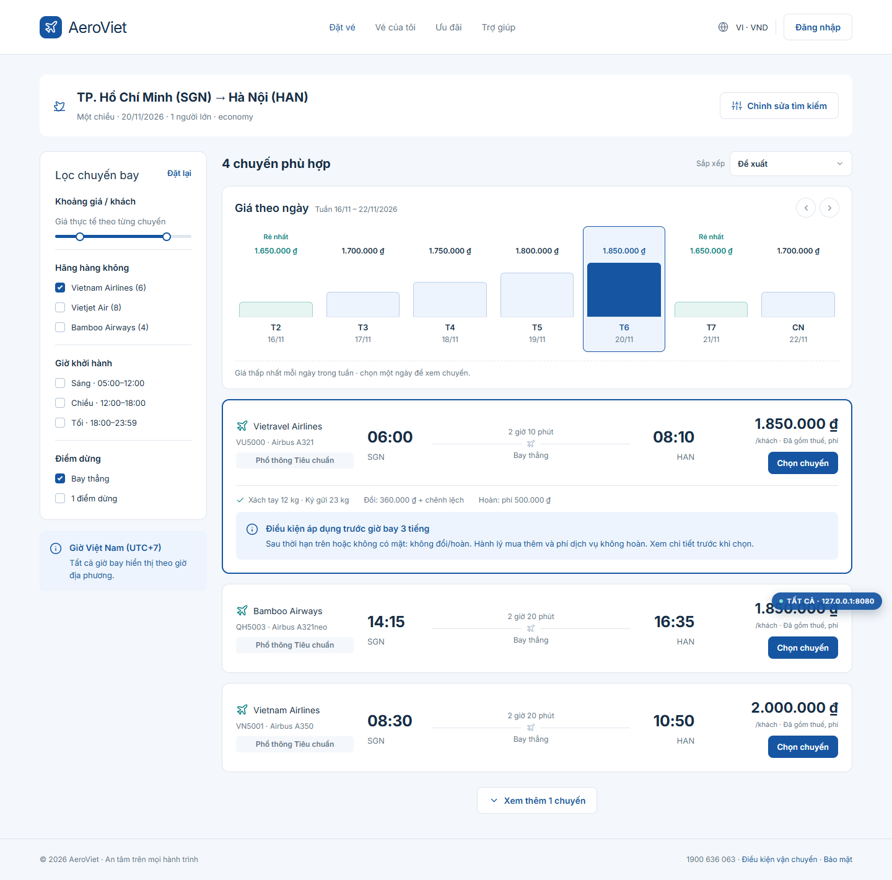
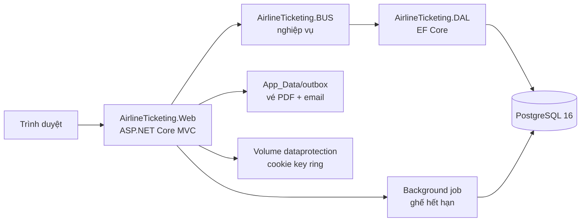

# AirlineTicketing

[](https://github.com/MinhVy1324/AirlineTicketingg/actions/workflows/ci.yml)
[](https://dotnet.microsoft.com/)
[](https://www.postgresql.org/)
[](compose.yaml)

Hệ thống bán vé máy bay xây dựng bằng **ASP.NET Core MVC + PostgreSQL**, chia ba khu vực **khách hàng —
nhân viên vận hành (manager) — quản trị viên (admin)**. Dự án chạy trọn gói bằng Docker Compose, có dữ liệu
seed, migration, test tích hợp, CI và kịch bản demo/báo cáo.

<p align="center">
  
  
</p>

## Điểm chính

- **Luồng nghiệp vụ khép kín:** tìm chuyến → chọn ghế → nhập hành khách → giữ chỗ có hạn → thanh toán
  (thẻ mô phỏng hoặc chuyển khoản) → phát hành vé PDF có QR → tra cứu → đổi/hoàn → báo cáo doanh thu.
- **Ba khu vực tách biệt:** mỗi khu có giao diện, quyền và trang mặc định riêng; có thể chạy 4 instance
  (tất cả, admin, manager, khách hàng) trên cùng một image.
- **Dữ liệu thật:** PostgreSQL + EF Core migrations; hơn 4.000 chuyến, 12 sân bay, 28 tuyến, booking ở
  nhiều trạng thái, thanh toán và yêu cầu đổi/hoàn.
- **An toàn cơ bản:** cookie auth theo vai trò, ownership check khi xem/tải vé, chống CSRF, rate limit đăng
  nhập và gửi lại email, không lưu số thẻ, không tự xác nhận chuyển khoản.
- **Vận hành demo:** Data Protection key ring nằm trong volume nên rebuild không mất phiên; job nền giải
  phóng ghế hết hạn; email vé ghi ra outbox khi chưa cấu hình SMTP.
- **Kiểm chứng tự động:** build + 48 test (40 unit, 8 tích hợp PostgreSQL) trên CI, kèm `smoke.ps1` kiểm tra
  health, 3 vai trò, CSV báo cáo và phân quyền PDF.

## Kiến trúc



| Tầng | Vai trò |
| --- | --- |
| `AirlineTicketing.Web` | MVC controllers, Razor views, middleware, xác thực, job nền |
| `AirlineTicketing.BUS` | Quy tắc nghiệp vụ: tìm chuyến, giữ chỗ, thanh toán, đổi/hoàn, báo cáo |
| `AirlineTicketing.DAL` | `AppDbContext`, cấu hình entity, migrations |
| `AirlineTicketing.Domain` / `DTO` | Entity và hợp đồng dữ liệu giữa các tầng |
| `AirlineTicketing.Tests` | Unit test + integration test qua `WebApplicationFactory` |

## Chức năng theo vai trò

| Vai trò | Màn hình | Chức năng |
| --- | --- | --- |
| Khách vãng lai | `/`, `/chuyen-bay`, `/tra-cuu` | Tìm/lọc/sắp xếp chuyến, xem sơ đồ ghế, đặt vé, thanh toán, tra cứu PNR + email |
| Khách hàng | `/ve-cua-toi` | Danh sách vé, tải PDF, gửi lại email, yêu cầu đổi/hoàn, theo dõi yêu cầu |
| Manager | `/quan-ly` | Dashboard vận hành, lịch bay, đặt chỗ, xác nhận chuyển khoản, duyệt đổi/hoàn, báo cáo + CSV |
| Admin | `/admin` | Dashboard hệ thống, tài khoản, ma trận quyền, danh mục, cấu hình nghiệp vụ, nhật ký |

## Tài khoản demo

Mật khẩu chung: `123456`

| Vai trò | Tên đăng nhập | Trang mặc định |
| --- | --- | --- |
| Admin | `admin` | `/admin` |
| Manager | `manager` | `/quan-ly` |
| Khách hàng | `minhanh` | `/ve-cua-toi` |
| Tài khoản bị khoá (minh hoạ) | `nam.user` | — |

> Đây là tài khoản seed cho môi trường phát triển/demo, **không dùng cho production**.

## Chạy nhanh bằng Docker

Yêu cầu: Docker Desktop (hoặc Docker Engine + Compose v2), Git.

```powershell
git clone https://github.com/MinhVy1324/AirlineTicketingg.git
cd AirlineTicketingg
Copy-Item .env.example .env      # đổi POSTGRES_PASSWORD
docker compose up --build -d
```

Kiểm tra: `http://127.0.0.1:8080/health/database` trả `status: connected`.

| Địa chỉ | Khu vực | Mở `/` sẽ tới |
| --- | --- | --- |
| http://127.0.0.1:8080 | Đầy đủ | Trang chủ khách hàng |
| http://127.0.0.3 | Khách hàng | Trang chủ khách hàng |
| http://127.0.0.1 | Admin | `/admin` |
| http://127.0.0.2 | Manager | `/quan-ly` |

> **Windows/macOS + Docker Desktop:** nếu `127.0.0.2`/`127.0.0.3` không truy cập được, đặt
> `WEB_PORT_MANAGER=8082`, `WEB_PORT_USER=8083` trong `.env` rồi dùng `http://127.0.0.1:8082/`,
> `http://127.0.0.1:8083/`. Chi tiết: [docs/INSTALL-WINDOWS.md](docs/INSTALL-WINDOWS.md).

### Lệnh thường dùng

```bash
docker compose ps                  # trạng thái dịch vụ
docker compose logs -f web         # log instance đầy đủ
docker compose down                # dừng, giữ dữ liệu
docker compose down -v             # dừng và xoá dữ liệu
pwsh ./scripts/smoke.ps1           # smoke test toàn hệ thống
pwsh ./scripts/reset-demo.ps1      # reset dữ liệu demo (có xác nhận)
```

## Kiểm thử và CI

```bash
# Có PostgreSQL test DB: chạy cả 48 test
AIRLINE_TEST_CONNECTION="Host=localhost;Port=5432;Database=airline_ticketing_test;Username=airline_app;Password=..." \
  dotnet test AirlineTicketing.Tests/AirlineTicketing.Tests.csproj

# Không có biến môi trường: 40 test chạy, 8 test tích hợp tự bỏ qua
dotnet test AirlineTicketing.Tests/AirlineTicketing.Tests.csproj
```

CI gồm 2 job: **build + unit test** và **integration test với PostgreSQL 16**. Xem
[`.github/workflows/ci.yml`](.github/workflows/ci.yml).

## Cấu trúc repository

```text
AirlineTicketing.Web/       # MVC, views, middleware, job nền, PDF/email
AirlineTicketing.BUS/       # nghiệp vụ
AirlineTicketing.DAL/       # EF Core, migrations
AirlineTicketing.Domain/    # entity
AirlineTicketing.DTO/       # DTO
AirlineTicketing.Tests/     # unit + integration test
docs/                       # phân tích, thiết kế, cài đặt, demo
scripts/                    # smoke test, reset dữ liệu demo
compose.yaml                # PostgreSQL + migrate + 4 web instance
```

## Tài liệu

| Tài liệu | Nội dung |
| --- | --- |
| [Kịch bản demo 15 phút](docs/DEMO-SCRIPT.md) | Thao tác, kết quả mong đợi, lời thoại, phương án dự phòng |
| [Checklist nghiệm thu](docs/DEMO-CHECKLIST.md) | Map FR/UC → màn hình, checklist theo vai trò, giới hạn demo |
| [Cài đặt](docs/INSTALL.md) | Chọn cách chạy, tài khoản demo, biến môi trường |
| [Docker & vận hành](docs/DOCKER-SETUP.md) | Compose, volume, health, xử lý sự cố |
| [Thiết kế cơ sở dữ liệu](docs/DATABASE-DESIGN.md) | ERD, ràng buộc, DTO |
| [Phân tích yêu cầu & use case](docs/PHAN-TICH-YEU-CAU-VA-USE-CASE.md) | FR-01…FR-13, UC-01…UC-12, traceability |
| [Quy trình làm việc nhóm](docs/TEAM-WORKFLOW.md) | Branch, PR, review, CI |
| [Ảnh chụp màn hình](docs/screenshots/) | Trang chủ, tìm chuyến, dashboard, báo cáo, quản trị |

## Giới hạn của bản demo

Bản này đạt mức **demo/báo cáo**, không phải production: thanh toán được mô phỏng (không có cổng thật),
email ghi ra outbox thay vì SMS, mỗi đơn phục vụ 01 hành khách, báo cáo theo ngày phát hành vé, phân quyền
cố định 03 vai trò và chưa chặn trùng lịch tàu bay. Chi tiết và cách trình bày khi bảo vệ:
[Checklist — Giới hạn đã biết](docs/DEMO-CHECKLIST.md#8-giới-hạn-đã-biết-của-bản-demo).
