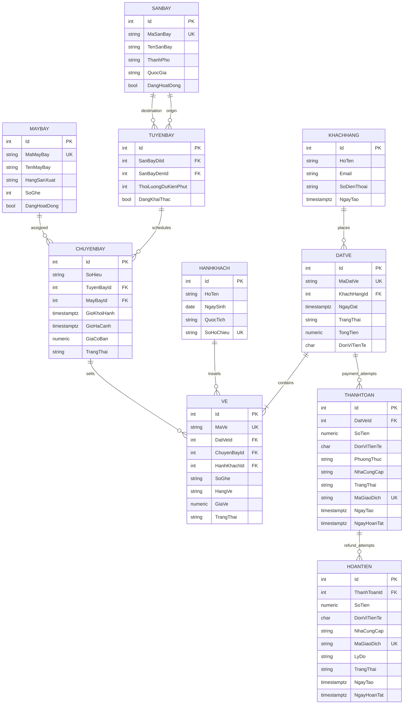

# Thiết kế cơ sở dữ liệu AirlineTicketing

Thiết kế dùng PostgreSQL và EF Core. `Id` là khóa nội bộ kiểu `integer`; mã nghiệp vụ như `MaVe`, `MaDatVe`, `MaSanBay` là khóa tra cứu duy nhất. Entity nằm trong `AirlineTicketing.Domain`, cấu hình quan hệ/ràng buộc nằm trong DAL, còn DTO là hợp đồng trao đổi dữ liệu và không tham chiếu EF/entity.

## ERD

## Vì sao tách các bảng

- `TuyenBay` là cặp sân bay đi/đến dùng lại được; `ChuyenBay` là một lịch bay cụ thể có máy bay, giờ và giá. Cặp sân bay của tuyến là duy nhất và sân bay đi phải khác sân bay đến.
- `KhachHang` là người liên hệ/đặt vé. `HanhKhach` là người thực sự bay; một người đặt có thể mua nhiều vé cho nhiều hành khách. Vé giữ FK đến hành khách, chuyến bay và đặt vé.
- `ThanhToan` tách khỏi `DatVe` để giữ nhiều lần thử thanh toán. `HoanTien` ghi từng lần hoàn riêng, giữ nguyên thanh toán gốc và cho phép hoàn nhiều phần.
- Trạng thái được lưu dưới dạng chuỗi enum để dễ đọc trong PostgreSQL và DTO. Mã tiền tệ dùng ISO 4217 dạng 3 ký tự; giá tiền dùng `numeric(12,2)`, không dùng `float`.
- Thời điểm dùng `DateTimeOffset`/`timestamptz`; dữ liệu gửi vào tầng lưu trữ cần chuẩn hóa UTC. Ngày sinh dùng `date` vì không phải thời điểm.

## Ràng buộc và chỉ mục

- Mã sân bay, mã máy bay, mã đặt vé, mã vé và mã giao dịch ngoài là duy nhất; các FK dùng `Restrict` để không xóa lịch sử đặt vé/thanh toán khi xóa dữ liệu danh mục.
- Có CHECK cho số ghế máy bay dương, giá không âm, giờ hạ cánh sau giờ khởi hành, và tuyến không nối cùng một sân bay.
- Chỉ mục tuyến + giờ khởi hành hỗ trợ tra cứu chuyến bay; chỉ mục máy bay + giờ hỗ trợ lịch khai thác; khách hàng + ngày đặt và đặt vé + trạng thái hỗ trợ tra cứu/quản trị.
- Unique index có điều kiện trên `(ChuyenBayId, SoGhe)` chặn giữ/phát hành cùng ghế đồng thời nhưng cho phép bán lại ghế sau khi vé cũ bị hủy/hoàn. Một hành khách cũng không thể có hai vé đang hiệu lực cho cùng chuyến bay.
- Mã giao dịch được unique theo nhà cung cấp thanh toán; mã null được phép cho lần thử chưa tới cổng thanh toán.
- Cần tạo booking/ticket trong transaction. Unique index là chốt chống bán trùng cuối cùng khi có nhiều request đồng thời; lỗi unique cần được trả về thành thông báo ghế vừa được người khác giữ.

## DTO chính

| Hợp đồng | Mục đích |
|---|---|
| `TimChuyenBayDTO` / `ChuyenBayDTO` | Tra cứu chuyến theo sân bay/ngày, nhận giờ, giá và số ghế còn |
| `SanBayDTO`, `TuyenBayDTO`, `MayBayDTO` | Danh mục/quản trị sân bay, tuyến và máy bay |
| `TaoDatVeDTO` / `DatVeDTO` | Tạo và xem đặt vé; mỗi vé có chuyến, ghế, hạng và hành khách |
| `HuyVeDTO` / `DoiVeDTO` | Gửi yêu cầu hủy hoặc đổi vé; BUS phải kiểm tra chính sách, chênh lệch giá và quyền sở hữu |
| `KhachHangDTO`, `HanhKhachDTO`, `VeDTO` | Hợp đồng riêng cho người liên hệ, người bay và vé |
| `TaoThanhToanDTO` / `ThanhToanDTO` / `HoanTienDTO` | Gửi yêu cầu thanh toán, xem giao dịch và lịch sử hoàn tiền |
| `ThongKeDoanhThuDTO` / `DoanhThuTheoNgayDTO` | Trả báo cáo tiền đã thu, tiền đã hoàn và doanh thu thuần |

DTO đầu vào có validation annotations cơ bản. BUS/API vẫn phải kiểm tra quyền, trạng thái nghiệp vụ, ghế còn, giới hạn trang và tổng tiền; không tin tổng tiền do client gửi. Server tính tổng từ giá chuyến bay và lưu snapshot trên từng vé/đặt vé.

## Docker và migration

`compose.yaml` giữ PostgreSQL trong named volume `postgres_data`, chờ health check đăng nhập được bằng chính user/database/mật khẩu trong `.env`, rồi mới khởi động web. `Database__ApplyMigrationsOnStartup=true` chạy EF migrations khi web khởi động. Doanh thu thuần tổng hợp theo cùng đơn vị tiền tệ: giao dịch thanh toán thành công trừ giao dịch hoàn tiền thành công trong kỳ. Mọi thay đổi model sau migration đầu cần tạo migration mới và commit cùng code; không xóa volume để cập nhật schema.
