# Phân tích yêu cầu và Use Case — AirlineTicketing

| Thuộc tính | Giá trị                                                                     |
| ---------- | --------------------------------------------------------------------------- |
| Phiên bản  | 1.1                                                                         |
| Ngày       | 28-10-2026                                                                  |
| Trạng thái | Bản đề xuất làm cơ sở thống nhất nghiệp vụ                                  |
| Phạm vi    | Website bán vé, quản trị danh mục/lịch bay, thanh toán và báo cáo doanh thu |

## 1. Mục tiêu và phạm vi

Hệ thống cho phép khách tìm chuyến bay, tạo đặt chỗ, thanh toán và nhận vé điện tử; nhân viên có thể tra cứu, hỗ trợ đổi/hủy; nhân viên khai thác quản lý sân bay, máy bay, tuyến bay và lịch chuyến; quản lý xem báo cáo doanh thu.

Tài liệu dùng quy trình **Shop → Order → Service/Cancel → Payment/Refund** làm khung nghiệp vụ. Đây cũng là các nhóm tương tác được IATA mô tả trong tài liệu Offer and Order/NDC; tài liệu này không yêu cầu tích hợp NDC hay GDS ở giai đoạn đầu ([IATA NDC factsheet](https://www.iata.org/en/iata-repository/pressroom/fact-sheets/fact-sheet-ndc/)).

### 1.1 Giả định cho bản đầu

- Hệ thống quản lý dữ liệu của một hãng/đơn vị khai thác; chưa đồng bộ tồn chỗ và giá trực tiếp từ GDS hoặc API hãng bay.
- Phạm vi đầu tiên là chuyến bay một chặng và một chiều. Khứ hồi, nối chuyến, nhóm khách, hành lý/ghế phụ thu là phần mở rộng.
- Giá, điều kiện đổi/hủy, thời hạn giữ chỗ và phí hoàn/đổi phải cấu hình được. Không gán một chính sách cố định cho mọi vé.
- Khách mua vé có thể là người đặt/thanh toán nhưng không phải hành khách. Thông tin liên hệ của người đặt và hồ sơ hành khách là hai khái niệm khác nhau.
- Cổng thanh toán là hệ thống ngoài. Ứng dụng chỉ lưu mã giao dịch/token tham chiếu, không lưu số thẻ đầy đủ hoặc CVV.

## 2. Thuật ngữ nghiệp vụ

| Thuật ngữ                | Ý nghĩa trong hệ thống                                                                                                                    |
| ------------------------ | ----------------------------------------------------------------------------------------------------------------------------------------- |
| Sân bay (`SanBay`)       | Điểm đi/đến có mã sân bay, tên, thành phố, quốc gia và múi giờ IANA.                                                                      |
| Tuyến bay (`TuyenBay`)   | Cặp sân bay theo chiều đi, ví dụ SGN → HAN. Tuyến không gắn với ngày/giờ cụ thể.                                                          |
| Chuyến bay (`ChuyenBay`) | Một lần khai thác tuyến bay vào ngày/giờ cụ thể bằng một máy bay cụ thể.                                                                  |
| Người đặt (`KhachHang`)  | Người liên hệ và chịu trách nhiệm tạo đặt chỗ; có thể không đi chuyến bay.                                                                |
| Hành khách (`HanhKhach`) | Người có tên trên vé và thực tế sử dụng vé. Một đặt chỗ có thể có nhiều hành khách.                                                       |
| Đặt chỗ (`DatVe`)        | Giao dịch nghiệp vụ gom thông tin liên hệ, hành khách, chi tiết từng chuyến/chặng, vé, thanh toán và lịch sử. Có thể đang chờ thanh toán. |
| Vé (`Ve`)                | Quyền sử dụng một chỗ trên một chuyến bay cho một hành khách, kèm hạng vé, giá và điều kiện đã bán.                                       |
| Thanh toán (`ThanhToan`) | Lần thu tiền/hoàn tiền được ghi nhận với cổng thanh toán. Một đặt chỗ có thể có nhiều lần thử thanh toán.                                 |
| Giá/điều kiện vé         | Giá được chốt tại thời điểm mua cùng điều kiện đổi, hủy, hoàn và hành lý áp dụng cho vé đó.                                               |

**Không dùng “tuyến bay” và “chuyến bay” thay thế cho nhau.** Chuyến bay tham chiếu một tuyến; nhiều chuyến bay ở các ngày khác nhau có thể dùng chung tuyến.

## 3. Actor và quyền/chức năng

| Actor                                  | Chức năng chính                                                                                                                                               |
| -------------------------------------- | ------------------------------------------------------------------------------------------------------------------------------------------------------------- |
| Khách vãng lai                         | Tìm chuyến, xem giá/tồn chỗ, nhập thông tin liên hệ và hành khách, tạo đặt chỗ, thanh toán; tra cứu bằng mã đặt chỗ và thông tin xác minh.                    |
| Khách hàng có tài khoản                | Các chức năng khách vãng lai; xem lịch sử đặt chỗ và quản lý thông tin liên hệ của chính mình.                                                                |
| Nhân viên bán vé / chăm sóc khách hàng | Tìm chuyến thay khách, tạo/tra cứu đặt chỗ, xem điều kiện vé, lập yêu cầu đổi/hủy, theo dõi thanh toán/hoàn tiền. Thao tác phải ghi người thực hiện và lý do. |
| Nhân viên khai thác                    | Quản lý trạng thái sân bay, máy bay, tuyến bay, chuyến bay; kiểm tra xung đột lịch và sức chứa. Không tự quyết định hoàn tiền nếu không có quyền tài chính.   |
| Kế toán / quản lý                      | Xem báo cáo, đối soát giao dịch, theo dõi hoàn tiền và tải báo cáo theo quyền được cấp. Không sửa vé/chuyến bay trực tiếp.                                    |
| Quản trị hệ thống                      | Quản lý tài khoản nhân viên, vai trò, tham số nghiệp vụ, phương thức thanh toán và nhật ký/audit.                                                             |
| Cổng thanh toán (ngoài hệ thống)       | Nhận yêu cầu thanh toán/hoàn tiền, trả kết quả đồng bộ hoặc webhook bất đồng bộ.                                                                              |
| Tác vụ nền của hệ thống                | Hết hạn giữ chỗ chưa thanh toán, xử lý webhook/retry, phát hành thông báo và cập nhật tác vụ hoàn tiền.                                                       |

Quyền phải được kiểm tra ở server/API. Ẩn nút trên giao diện không thay thế kiểm soát quyền. Nhân viên chỉ xem dữ liệu cá nhân cần thiết cho công việc.

## 4. Quy trình bán vé từ đầu đến cuối

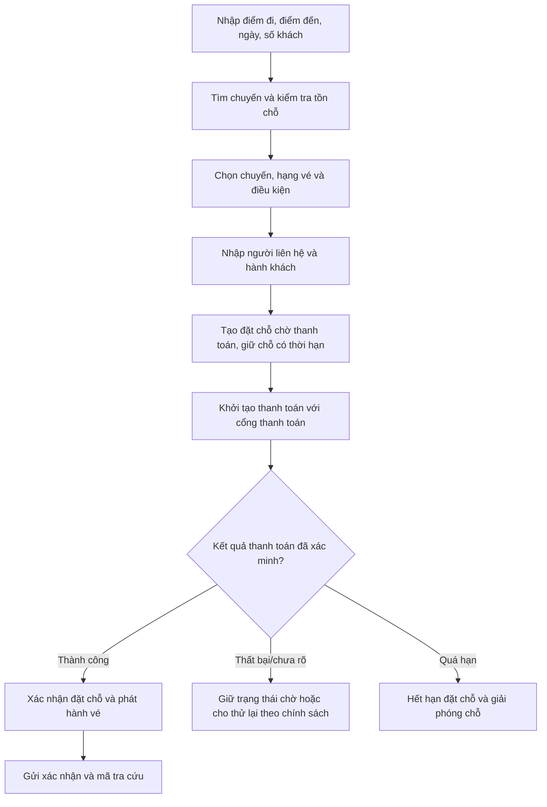

1. Tìm chuyến chỉ hiển thị giá/tồn chỗ tham khảo tại thời điểm truy vấn; trước khi tạo đặt chỗ phải kiểm tra lại.
2. Khi tạo đặt chỗ, hệ thống kiểm tra sức chứa và giữ số chỗ tương ứng trong một khoảng thời gian cấu hình được. Gợi ý ban đầu: 15 phút; chủ nghiệp vụ cần chốt.
3. Trạng thái đặt chỗ là `PENDING_PAYMENT` cho tới khi xác nhận được giao dịch thành công từ cổng thanh toán.
4. Khi thanh toán thành công, chuyển đặt chỗ sang `CONFIRMED`, ghi nhận giao dịch, tạo vé và mã vé duy nhất. Webhook trùng phải xử lý idempotent, không phát hành vé hai lần.
5. Khi thanh toán thất bại hoặc hết hạn, không đánh dấu đặt chỗ đã bán. Hệ thống giải phóng chỗ theo chính sách và lưu lịch sử.

## 5. Danh mục yêu cầu chức năng

| Mã    | Yêu cầu                                                                                                                                              |
| ----- | ---------------------------------------------------------------------------------------------------------------------------------------------------- |
| FR-01 | Khách tìm chuyến theo sân bay đi/đến, ngày đi, số hành khách và hạng vé; lọc/sắp xếp theo giờ, giá, thời lượng và số điểm dừng trong phạm vi hỗ trợ. |
| FR-02 | Hệ thống chỉ hiển thị chuyến đang mở bán; kiểm tra lại tồn chỗ và giá trước khi tạo đặt chỗ.                                                         |
| FR-03 | Khách nhập người liên hệ và một hoặc nhiều hành khách; dữ liệu phải được xác thực trước khi giữ chỗ.                                                 |
| FR-04 | Hệ thống tạo mã đặt chỗ không tuần tự, giữ chỗ có hạn, tính tổng tiền và trả về thời điểm hết hạn thanh toán.                                        |
| FR-05 | Hệ thống tạo thanh toán, nhận kết quả, xử lý callback/webhook idempotent, phát hành vé sau khi xác nhận thanh toán.                                  |
| FR-06 | Khách/nhân viên tra cứu đặt chỗ bằng mã đặt chỗ cùng thông tin xác minh; kết quả chỉ trả dữ liệu cần thiết.                                          |
| FR-07 | Khách/nhân viên xem điều kiện vé trước khi gửi yêu cầu hủy/đổi; hệ thống tính phí, tiền chênh lệch và số tiền dự kiến hoàn.                          |
| FR-08 | Hệ thống ghi lại yêu cầu, người thao tác, lý do, giá trước/sau, phí và kết quả xử lý đổi/hủy/hoàn tiền.                                              |
| FR-09 | Nhân viên khai thác tạo/cập nhật/ngừng sử dụng sân bay, máy bay và tuyến bay; dữ liệu đang được tham chiếu không bị xóa cứng.                        |
| FR-10 | Nhân viên khai thác tạo/cập nhật chuyến bay; hệ thống kiểm tra sân bay, máy bay, thời gian, sức chứa và xung đột sử dụng máy bay.                    |
| FR-11 | Quản trị viên cấu hình người dùng, vai trò và tham số nghiệp vụ; mọi thay đổi nhạy cảm có audit log.                                                 |
| FR-12 | Kế toán/quản lý xem báo cáo theo khoảng ngày, chuyến, tuyến, trạng thái thanh toán; phân biệt doanh số gộp, hoàn tiền và doanh thu thuần.            |
| FR-13 | Hệ thống cung cấp thông báo xác nhận, thất bại, hết hạn, thay đổi lịch, hủy và hoàn tiền theo kênh cấu hình (email/SMS ở phạm vi triển khai).        |

## 6. Use Case

### UC-01 — Tra cứu chuyến bay

- **Actor chính:** Khách vãng lai, khách hàng, nhân viên bán vé.
- **Tiền điều kiện:** Sân bay và tuyến bay hoạt động; có dữ liệu chuyến trong ngày tìm kiếm.
- **Luồng chính:** (1) Actor chọn sân bay đi, sân bay đến, ngày đi, số khách và hạng vé. (2) Hệ thống kiểm tra dữ liệu, không cho điểm đi trùng điểm đến và ngày đi không hợp lệ. (3) Hệ thống tìm chuyến ở trạng thái mở bán, kiểm tra sức chứa và tính/đọc giá hiện hành. (4) Hệ thống trả danh sách với giờ địa phương, sân bay, thời lượng, giá, tiền tệ, hạng vé và số chỗ ước tính.
- **Ngoại lệ:** Không có chuyến thì trả danh sách rỗng và gợi ý đổi ngày; chuyến vừa hết chỗ thì loại khỏi kết quả hoặc đánh dấu không còn bán; lỗi truy vấn thì trả lỗi có mã theo dõi, không trả stack trace.
- **Hậu điều kiện:** Không tạo đặt chỗ và không trừ chỗ.

### UC-02 — Tạo đặt chỗ và giữ chỗ

- **Actor chính:** Khách vãng lai/khách hàng; nhân viên bán vé là actor thay thế.
- **Tiền điều kiện:** Chuyến còn mở bán; giá/điều kiện được công bố.
- **Luồng chính:** (1) Actor chọn chuyến và số lượng hành khách. (2) Nhập người liên hệ, thông tin từng hành khách, hạng vé và lựa chọn được hỗ trợ. (3) Hệ thống xác thực thông tin, kiểm tra tồn chỗ và tính lại giá. (4) Hệ thống tạo `DatVe` trạng thái `PENDING_PAYMENT`, giữ chỗ đến `HetHanThanhToanUtc`, sinh mã đặt chỗ và trả tổng tiền/tiền tệ. (5) Actor tiếp tục sang thanh toán.
- **Ngoại lệ:** Giá thay đổi thì hiển thị giá mới và yêu cầu xác nhận lại; thiếu chỗ thì không tạo đặt chỗ; tạo lại cùng idempotency key thì trả cùng kết quả, không tạo booking trùng.
- **Hậu điều kiện:** Có một đặt chỗ chờ thanh toán và lượng chỗ tương ứng được giữ tạm thời.

### UC-03 — Thanh toán và phát hành vé

- **Actor chính:** Khách hàng; actor phụ là cổng thanh toán và tác vụ nền.
- **Tiền điều kiện:** Đặt chỗ còn hạn và đang `PENDING_PAYMENT`.
- **Luồng chính:** (1) Hệ thống tạo `ThanhToan` trạng thái `PENDING` và gửi yêu cầu tới cổng thanh toán. (2) Khách hoàn tất bước thanh toán tại cổng. (3) Cổng trả kết quả hoặc webhook có chữ ký. (4) Hệ thống xác minh chữ ký, mã đơn, số tiền, tiền tệ và trạng thái; ghi giao dịch đúng một lần. (5) Nếu thành công, xác nhận đặt chỗ, phát hành một vé cho mỗi hành khách/chặng, ghi mã vé và gửi thông báo.
- **Ngoại lệ:** Thất bại thì giữ trạng thái thất bại và cho thử lại nếu booking còn hạn; kết quả chưa rõ thì chờ webhook/đối soát, không phát hành vé; webhook gửi lặp thì trả kết quả đã xử lý; thanh toán đến sau khi hết hạn thì đưa vào quy trình đối soát/hoàn tiền, không tự đặt lại chỗ.
- **Hậu điều kiện:** Booking đã xác nhận và vé được phát hành, hoặc booking còn chờ/đã hết hạn với lịch sử thanh toán đầy đủ.

### UC-04 — Tra cứu đặt chỗ

- **Actor chính:** Khách hàng; nhân viên hỗ trợ được phân quyền.
- **Tiền điều kiện:** Có mã đặt chỗ. Khách không đăng nhập phải xác minh thêm email hoặc số điện thoại đã lưu.
- **Luồng chính:** (1) Nhập mã đặt chỗ và thông tin xác minh. (2) Hệ thống áp dụng giới hạn thử sai và so khớp an toàn. (3) Trả trạng thái, người liên hệ đã che bớt thông tin nhạy cảm, chuyến, hành khách, vé, thanh toán ở mức phù hợp và các thao tác được phép.
- **Ngoại lệ:** Sai mã/thông tin trả thông báo chung, không tiết lộ booking có tồn tại hay không; nhân viên không đủ quyền bị từ chối và ghi log.
- **Hậu điều kiện:** Chỉ đọc dữ liệu; không thay đổi booking.

### UC-05 — Hủy đặt chỗ/vé và hoàn tiền

- **Actor chính:** Khách hàng hoặc nhân viên hỗ trợ; actor phụ là cổng thanh toán.
- **Tiền điều kiện:** Booking/vé tồn tại, chưa sử dụng và còn trong điều kiện xử lý theo quy tắc của hạng vé.
- **Luồng chính:** (1) Tra cứu và chọn vé/hành khách cần hủy. (2) Hệ thống đọc phiên bản điều kiện vé đã bán, tính phí hủy và số tiền dự kiến hoàn. (3) Hiển thị rõ số tiền trước/sau phí và yêu cầu xác nhận. (4) Ghi yêu cầu hủy và cập nhật trạng thái; giải phóng chỗ khi chính sách cho phép. (5) Nếu phải hoàn tiền, tạo giao dịch hoàn và theo dõi tới `SUCCEEDED` hoặc `FAILED`. (6) Gửi thông báo và lưu audit log.
- **Ngoại lệ:** Không đủ điều kiện thì nêu lý do; hoàn tiền thất bại không được giả lập là đã hoàn; thao tác lặp trả kết quả cũ; hủy một phần chỉ tác động vé/hành khách được chọn.
- **Hậu điều kiện:** Vé bị hủy/hoàn theo kết quả thực tế; giao dịch gốc vẫn được giữ để đối soát.

### UC-06 — Đổi chuyến/đổi vé

- **Actor chính:** Khách hàng hoặc nhân viên hỗ trợ; actor phụ là cổng thanh toán.
- **Tiền điều kiện:** Vé chưa sử dụng; điều kiện vé cho phép đổi; chuyến mới còn chỗ.
- **Luồng chính:** (1) Tra cứu booking và chọn vé cần đổi. (2) Chọn chuyến mới. (3) Hệ thống kiểm tra điều kiện vé, tồn chỗ, phí đổi, giá mới và chênh lệch. (4) Hiển thị phương án trước khi xác nhận. (5) Giữ chỗ mới trong thời gian xử lý. (6) Thu thêm tiền hoặc tạo hoàn phần chênh lệch theo quy tắc. (7) Chỉ sau khi giao dịch cần thiết thành công, chuyển vé sang chuyến mới, giải phóng chỗ cũ, phát hành lại vé và ghi lịch sử.
- **Ngoại lệ:** Không đủ chỗ/không đủ điều kiện thì giữ nguyên vé cũ; thanh toán chênh lệch thất bại thì hủy giữ chỗ mới; nếu giao dịch đã thành công nhưng cập nhật booking lỗi, đưa vào hàng đợi đối soát/retry idempotent, không tạo vé thứ hai.
- **Hậu điều kiện:** Vé cũ được thay thế theo lịch sử; booking và tổng tiền phản ánh kết quả cuối.

### UC-07 — Quản lý sân bay

- **Actor chính:** Nhân viên khai thác.
- **Luồng chính:** Tạo/cập nhật mã sân bay, tên, thành phố, quốc gia, múi giờ IANA và trạng thái. Hệ thống kiểm tra mã duy nhất, độ dài và dữ liệu bắt buộc.
- **Ngoại lệ/hậu điều kiện:** Không xóa cứng sân bay đã được tuyến/chuyến tham chiếu; chỉ cho ngừng khai thác. Thay đổi múi giờ không được âm thầm thay đổi các thời điểm chuyến đã bán; lưu audit.

### UC-08 — Quản lý máy bay

- **Actor chính:** Nhân viên khai thác.
- **Luồng chính:** Tạo/cập nhật mã đăng ký, loại máy bay, hãng sản xuất, sức chứa/cấu hình ghế và trạng thái khai thác. Kiểm tra mã duy nhất, sức chứa dương và tính khả dụng.
- **Ngoại lệ/hậu điều kiện:** Không gán máy bay bảo trì/ngừng khai thác vào chuyến mới; không giảm sức chứa dưới số vé đã bán; thay đổi cấu hình ghế phải được kiểm soát và lưu lịch sử.

### UC-09 — Quản lý tuyến bay

- **Actor chính:** Nhân viên khai thác.
- **Luồng chính:** Chọn sân bay đi/đến, nhập thông tin tuyến (mã, khoảng cách/thời lượng chuẩn nếu cần), bật/tắt trạng thái.
- **Ngoại lệ/hậu điều kiện:** Không cho sân bay đi trùng sân bay đến; cặp sân bay có chiều đi khác chiều về là hai tuyến khác nhau; không xóa cứng tuyến đã có chuyến.

### UC-10 — Lập và quản lý chuyến bay

- **Actor chính:** Nhân viên khai thác.
- **Luồng chính:** Chọn tuyến, máy bay, số hiệu, giờ khởi hành/hạ cánh, giá/hạng vé và thời điểm mở bán. Hệ thống kiểm tra thời gian hợp lệ, máy bay hoạt động, thời gian quay đầu và xung đột lịch máy bay; thiết lập trạng thái `SCHEDULED`.
- **Ngoại lệ/hậu điều kiện:** Chuyến đã bán vé không được xóa; đổi giờ, máy bay hoặc hủy chuyến phải lưu phiên bản/lý do và tạo quy trình thông báo, đổi chuyến hoặc hoàn tiền cho khách bị ảnh hưởng.

### UC-11 — Đối soát thanh toán/hoàn tiền

- **Actor chính:** Kế toán; actor phụ là cổng thanh toán và tác vụ nền.
- **Luồng chính:** Tra cứu theo mã giao dịch, booking, khoảng ngày, trạng thái; so số tiền/tiền tệ/kết quả với cổng; ghi chú hoặc khởi tạo xử lý ngoại lệ.
- **Ngoại lệ/hậu điều kiện:** Không sửa lịch sử giao dịch đã thành công; điều chỉnh phải là giao dịch bù/hoàn riêng và có người duyệt/audit. Không hiển thị thông tin thẻ nhạy cảm.

### UC-12 — Thống kê doanh thu

- **Actor chính:** Kế toán/Quản lý.
- **Tiền điều kiện:** Actor có quyền xem báo cáo.
- **Luồng chính:** Chọn khoảng ngày, tuyến/chuyến, trạng thái và tiền tệ. Hệ thống tổng hợp số booking, số vé, khoản thanh toán thành công, hoàn tiền thành công, phí/phụ thu và doanh thu thuần; cho xem chi tiết nguồn số liệu và xuất báo cáo.
- **Quy tắc:** `DoanhThuThuanTienMat = TongThanhToanThanhCong - TongHoanTienThanhCong`. Báo cáo phải chỉ rõ ngày lọc dựa trên ngày đặt, ngày thu tiền hay ngày bay. Mặc định báo cáo dòng tiền dùng ngày giao dịch; báo cáo theo ngày bay là báo cáo riêng. Không cộng booking chờ/thất bại hoặc yêu cầu hoàn chưa thành công vào tiền thực thu.
- **Hậu điều kiện:** Chỉ đọc dữ liệu; xuất file được audit và tuân theo phân quyền.

## 7. Quy tắc nghiệp vụ và vòng đời trạng thái

### 7.1 Trạng thái tách biệt theo đối tượng

| Đối tượng                 | Trạng thái đề xuất                                                                                    |
| ------------------------- | ----------------------------------------------------------------------------------------------------- |
| Đặt chỗ                   | `PENDING_PAYMENT`, `CONFIRMED`, `EXPIRED`, `CANCELLATION_PENDING`, `CANCELLED`, `PARTIALLY_CANCELLED` |
| Giao dịch thanh toán/hoàn | `PENDING`, `SUCCEEDED`, `FAILED`, `CANCELLED`; `LoaiGiaoDich` phân biệt `PAYMENT` và `REFUND`         |
| Vé                        | `VALID`, `CANCELLED`, `VOIDED`, `REFUNDED`, `REISSUED`                                                |
| Chuyến bay                | `DRAFT`, `SCHEDULED`, `DELAYED`, `CANCELLED`, `BOARDING`, `DEPARTED`, `ARRIVED`                       |
| Sân bay/máy bay/tuyến     | `ACTIVE`, `INACTIVE` (máy bay có thể cần thêm `MAINTENANCE`)                                          |

Không dùng một trường `TrangThai` để đại diện đồng thời trạng thái đặt chỗ, thanh toán và vé. Mã trạng thái lưu theo mã ổn định; giao diện ánh xạ sang tiếng Việt.

### 7.2 Bất biến dữ liệu quan trọng

- Nếu khách được chọn ghế, một ghế trên một chuyến chỉ bán/giữ cho một booking tại cùng thời điểm; cần unique constraint phù hợp cho chuyến/ghế và concurrency control khi giữ chỗ.
- Tổng chỗ đã bán và chỗ giữ chưa hết hạn theo từng hạng vé không vượt sức chứa mở bán của hạng vé trên chuyến; tổng sức chứa các hạng không vượt cấu hình khai thác của máy bay.
- Giá, tiền tệ và điều kiện đổi/hủy được chụp lại trên booking/vé tại thời điểm bán; cập nhật bảng giá sau này không sửa lịch sử vé đã bán.
- Mã đặt chỗ, mã vé và mã giao dịch là mã công khai ngẫu nhiên/không tuần tự, có unique constraint; `Id` chỉ là khóa nội bộ.
- Callback thanh toán, hủy và đổi phải idempotent. Một mã giao dịch thành công không được ghi nhận hoặc hoàn hai lần.
- Không xóa cứng dữ liệu đã có giao dịch; dùng trạng thái ngừng hoạt động và audit log.
- Mọi thời điểm hết hạn/đặt/thu/hoàn được lưu dưới dạng UTC; hiển thị theo múi giờ sân bay hoặc múi giờ giao diện.

## 8. Yêu cầu phi chức năng

- **Bảo mật:** Xác thực và phân quyền theo vai trò; rate limit tra cứu mã booking; chống lộ thông tin khách; secrets chỉ qua biến môi trường/secret store; xác minh webhook; không ghi token/thông tin thẻ vào log.
- **Tính nhất quán:** Tạo booking và giữ chỗ trong một giao dịch; unique constraint và xử lý cạnh tranh; thanh toán/hoàn tiền qua state machine và idempotency key.
- **Audit:** Lưu actor, thời điểm UTC, thao tác, lý do và giá trị trước/sau cho quản trị danh mục, đổi/hủy, chỉnh giá, hoàn tiền và phân quyền.
- **Khả năng truy vết:** Log có correlation ID; không log dữ liệu cá nhân/thanh toán vượt nhu cầu.
- **Hiệu năng:** Tìm chuyến và tra cứu booking có phân trang/giới hạn kết quả; mục tiêu p95 và số người dùng đồng thời cần được thống nhất trước nghiệm thu.
- **Sao lưu/khôi phục:** Backup PostgreSQL định kỳ, kiểm tra khôi phục; thời gian lưu audit và dữ liệu cá nhân cần được chủ hệ thống chốt.
- **Khả dụng:** Lỗi cổng thanh toán không làm mất booking; worker có retry có giới hạn và hàng chờ xử lý thủ công khi kết quả không rõ.

## 9. Mô hình dữ liệu đích và khoảng cách với code hiện tại

| Thành phần                        | Vai trò                                                                                                  | Tình trạng trong project hiện tại                                                             |
| --------------------------------- | -------------------------------------------------------------------------------------------------------- | --------------------------------------------------------------------------------------------- |
| `SanBay`                          | Danh mục sân bay, cần thêm mã IATA/múi giờ/trạng thái theo quy ước.                                      | Đã có entity và EF configuration cơ bản.                                                      |
| `MayBay`                          | Đăng ký, loại máy bay, cấu hình ghế, trạng thái.                                                         | Đã có entity; cần chốt cấu hình ghế và trạng thái bảo trì.                                    |
| `TuyenBay`                        | Cặp sân bay đi/đến; quan hệ 1-n với chuyến bay.                                                          | Chưa có; nên bổ sung để phân biệt tuyến với chuyến cụ thể.                                    |
| `ChuyenBay`                       | Lịch khai thác của tuyến bằng máy bay; giờ và trạng thái.                                                | Đã có entity, hiện lưu trực tiếp `SanBayDiId`/`SanBayDenId`; có thể chuyển sang `TuyenBayId`. |
| `HangVe`, `ChuyenBayHangVe`       | Hạng khoang/loại giá và sức chứa, giá bán theo từng chuyến.                                              | Chưa có; nên tách tồn kho và giá khỏi `ChuyenBay`.                                            |
| `ChiTietDatVe`                    | Một hành khách trên một chuyến/chặng, giá chốt và phiên bản điều kiện vé.                                | Chưa có; cần bổ sung để hỗ trợ nhiều hành khách/chặng và đổi vé có lịch sử.                   |
| `DatVe`                           | Booking, người liên hệ, tổng tiền, tiền tệ, trạng thái, hạn giữ chỗ.                                     | Đã có entity cơ bản; cần thêm tổng tiền, tiền tệ, hạn thanh toán và lịch sử.                  |
| `HanhKhach`                       | Người đi trên vé; tách khỏi người liên hệ.                                                               | Chưa có; cần bổ sung để hỗ trợ booking nhiều khách.                                           |
| `Ve`                              | Một lần phát hành quyền bay của hành khách trên một chặng; gắn qua `ChiTietDatVe` để giữ lịch sử đổi vé. | Đã có entity cơ bản; cần tham chiếu chi tiết đặt vé và lưu điều kiện/giá bán.                 |
| `GiaoDichThanhToan` (`ThanhToan`) | Lần thu tiền/hoàn tiền, provider, mã ngoài, trạng thái.                                                  | Chưa có; cần bổ sung trước khi tích hợp thanh toán thật.                                      |
| `LichSuDatVe`                     | Lịch sử đổi/hủy, lý do, phí/chênh lệch, actor.                                                           | Chưa có; cần bổ sung để audit và đối soát.                                                    |
| `QuyTacVe`                        | Điều kiện giá, hạn đổi/hủy và phí; cần snapshot phiên bản lúc bán.                                       | Chưa có; nên lưu chính sách có phiên bản và snapshot áp dụng cho từng chi tiết đặt vé.        |

Quan hệ tối thiểu: `SanBay` → `TuyenBay` (vai trò đi/đến); `TuyenBay` → `ChuyenBay`; `MayBay` → `ChuyenBay`; `ChuyenBay` → tồn kho `ChuyenBayHangVe`; `DatVe` → `HanhKhach`, `ChiTietDatVe`, `GiaoDichThanhToan`, `LichSuDatVe`; mỗi `ChiTietDatVe` tham chiếu một hành khách, một chuyến/hạng vé và có thể phát hành một hay nhiều bản ghi vé lịch sử nhưng tối đa một vé còn hiệu lực.

## 10. Quy ước đặt tên, định dạng và DTO

### 10.1 Tên trong C# và cơ sở dữ liệu

- Giữ thuật ngữ tiếng Việt không dấu như các entity hiện có: `SanBay`, `TuyenBay`, `ChuyenBay`, `DatVe`, `HanhKhach`, `ThanhToan`.
- Type, property, method dùng `PascalCase`; biến cục bộ/tham số dùng `camelCase`; field private dùng `_camelCase`; hằng số dùng `PascalCase`.
- Entity là danh từ số ít, không thêm hậu tố `Entity`; DTO có hậu tố `DTO`; request/response dùng hậu tố rõ: `TimChuyenBayRequestDTO`, `TaoDatVeRequestDTO`, `DatVeResponseDTO`.
- Business service giữ quy ước hiện có `ChuyenBayBUS`, `DatVeBUS`; mỗi service gọi nghiệp vụ, không trả EF entity cho Web.
- Tên bảng/cột PostgreSQL dùng `snake_case` chữ thường: `san_bay`, `tuyen_bay`, `chuyen_bay`, `hang_ve`, `chuyen_bay_hang_ve`, `dat_ve`, `hanh_khach`, `chi_tiet_dat_ve`, `ve`, `giao_dich_thanh_toan`; khóa ngoại có hậu tố `_id`, ví dụ `chuyen_bay_id`.
- PK/FK dùng cùng kiểu hiện tại (`int`) trong bản đầu; không trộn `int`, `long`, `int` trong cùng hệ quan hệ. Mã nghiệp vụ như `MaDatVe` là chuỗi riêng, không thay `Id`.

### 10.2 Định dạng dữ liệu

| Dữ liệu                | Quy ước                                                                                                                                      |
| ---------------------- | -------------------------------------------------------------------------------------------------------------------------------------------- |
| JSON property          | `camelCase`, UTF-8; ví dụ `maDatVe`, `gioKhoiHanhUtc`.                                                                                       |
| Ngày lịch              | ISO 8601 `yyyy-MM-dd`, ví dụ `2026-11-20`; dùng cho ngày tìm chuyến, không gắn giờ.                                                          |
| Thời điểm              | ISO 8601 UTC có `Z`, ví dụ `2026-11-20T03:30:00Z`; C# dùng `DateTimeOffset` chuẩn hóa UTC, PostgreSQL dùng `timestamp with time zone`.       |
| Giờ địa phương sân bay | Chuyển từ UTC bằng múi giờ IANA của sân bay, ví dụ `Asia/Ho_Chi_Minh`; không lưu giờ địa phương mơ hồ như thời điểm gốc.                     |
| Tiền                   | C# `decimal`, PostgreSQL `numeric(18,2)`; JSON là số decimal, không dùng `float/double`. Luôn kèm `currencyCode` theo ISO 4217, ví dụ `VND`. |
| Số điện thoại          | Lưu chuẩn quốc tế E.164 khi có thể, ví dụ `+84901234567`; validate và giữ định dạng hiển thị riêng nếu cần.                                  |
| Email                  | Trim khoảng trắng; kiểm tra định dạng; so sánh theo quy tắc không phân biệt hoa/thường đã thống nhất.                                        |
| Mã sân bay             | Chữ hoa ASCII, 3 ký tự theo mã IATA nếu phạm vi yêu cầu mã IATA.                                                                             |
| Mã đặt chỗ/mã vé       | Chuỗi uppercase dễ đọc, duy nhất, không tuần tự; không mã hóa thông tin cá nhân vào mã.                                                      |
| Boolean/nullable       | Dùng `true/false`; trường chưa biết để `null`, không dùng chuỗi rỗng để thay giá trị chưa có.                                                |
| Trạng thái             | Mã ổn định dạng `UPPER_SNAKE_CASE`, ví dụ `PENDING_PAYMENT`; UI mới dịch sang nhãn tiếng Việt.                                               |

### 10.3 Quy tắc thiết kế DTO

- DTO là hợp đồng giữa Web/BUS; không chứa `DbContext`, EF navigation, `ICollection` entity hoặc thuộc tính persistence nội bộ.
- Tách request và response; không nhận `Id`, trạng thái thanh toán hoặc tổng tiền do client tự khai nếu server phải tự tính.
- Trả đúng dữ liệu theo vai trò. `DatVeDTO` có thể chứa người liên hệ và danh sách vé; `VeDTO` không lặp lại toàn bộ `KhachHangDTO` nếu thông tin đó đã nằm ở booking.
- Không đưa mật khẩu, access token cổng thanh toán, số thẻ đầy đủ, CVV hoặc thông tin nội bộ vào DTO phản hồi.
- Danh sách dùng tên rõ như `DanhSachVe`; thời điểm trả UTC; tiền luôn có `TienTe`/`CurrencyCode`.
- DTO tìm kiếm nên có phân trang/giới hạn; DTO chi tiết booking nên có dữ liệu đủ để hiển thị và thực hiện đúng thao tác.

### 10.4 DTO đề xuất

| DTO                             | Dữ liệu chính                                                                                                            |
| ------------------------------- | ------------------------------------------------------------------------------------------------------------------------ |
| `TimChuyenBayRequestDTO`        | `SanBayDiId`, `SanBayDenId`, `NgayDi`, `SoHanhKhach`, `HangVe`, thông tin phân trang/sắp xếp.                            |
| `ChuyenBayDTO`                  | `Id`, `SoHieu`, tuyến, giờ UTC, múi giờ/giờ địa phương hiển thị, giá thấp nhất, tiền tệ, chỗ còn bán, trạng thái mở bán. |
| `SanBayDTO`                     | `Id`, `MaSanBay`, `TenSanBay`, `ThanhPho`, `QuocGia`, `MaMuiGioIana`, `TrangThai`.                                       |
| `MayBayDTO`                     | `Id`, `MaMayBay`, `TenMayBay`, `HangSanXuat`, `SoGhe`, `TrangThai`.                                                      |
| `TuyenBayDTO`                   | `Id`, `SanBayDiId`, `SanBayDenId`, `MaTuyen`, `KhoangCachKm`, `TrangThai`.                                               |
| `KhachHangDTO`                  | Người liên hệ: `HoTen`, `Email`, `SoDienThoai`. Không mặc định đây là hành khách.                                        |
| `HanhKhachDTO`                  | `HoTen`, ngày sinh/loại hành khách và giấy tờ chỉ khi nghiệp vụ thực sự cần; không thu thập quá mức.                     |
| `TaoDatVeRequestDTO`            | `ChuyenBayId`, `KhachHang`, `DanhSachHanhKhach`, hạng vé, mã chống gửi lặp (`IdempotencyKey`).                           |
| `DatVeDTO`                      | `Id`, `MaDatVe`, `TrangThai`, `NgayDatUtc`, `HetHanThanhToanUtc`, `TongTien`, `TienTe`, `KhachHang`, `DanhSachVe`.       |
| `VeDTO`                         | `MaVe`, `TenHanhKhach`, `SoHieuChuyenBay`, điểm đi/đến, giờ UTC, `SoGhe`, `HangVe`, `GiaVe`, `TienTe`, `TrangThai`.      |
| `GiaoDichThanhToanDTO`          | `MaGiaoDich`, `LoaiGiaoDich`, `SoTien`, `TienTe`, `TrangThai`, `PhuongThuc`, `NgayThanhToanUtc`; không có dữ liệu thẻ.   |
| `ChiTietDatVeDTO`               | Tóm tắt hành khách, chuyến, hạng vé, giá chốt, điều kiện vé áp dụng và trạng thái vé.                                    |
| `BaoGiaHuyDTO` / `BaoGiaDoiDTO` | Điều kiện áp dụng, phí, số tiền thu thêm/hoàn, tiền tệ và thời điểm hết hiệu lực báo giá.                                |
| `HuyVeRequestDTO`               | Danh sách mã vé cần hủy, lý do; server tự tính phí/hoàn và trả bản xem trước.                                            |
| `DoiVeRequestDTO`               | Mã vé, chuyến mới, lý do; server tự tính phí/chênh lệch và kiểm tra tồn chỗ.                                             |
| `ThongKeDoanhThuDTO`            | Khoảng ngày và kiểu ngày lọc, tổng thu thành công, tổng hoàn thành công, doanh thu thuần, tiền tệ, số giao dịch/booking. |

Ví dụ JSON tạo đặt chỗ:

```json
{
  "chuyenBayId": 1204,
  "khachHang": {
    "hoTen": "Nguyen Van A",
    "email": "a@example.com",
    "soDienThoai": "+84901234567"
  },
  "danhSachHanhKhach": [
    {
      "hoTen": "Nguyen Van B",
      "loaiHanhKhach": "ADULT"
    }
  ],
  "hangVe": "ECONOMY",
  "idempotencyKey": "3a7e55fd-9436-4a9c-b78d-284c84a843bd"
}
```

Ví dụ phản hồi thời gian/tiền:

```json
{
  "maDatVe": "AB7KQ2",
  "trangThai": "PENDING_PAYMENT",
  "hetHanThanhToanUtc": "2026-11-20T03:45:00Z",
  "tongTien": 1250000.0,
  "tienTe": "VND",
  "danhSachVe": []
}
```

## 11. Quyết định cần chủ nghiệp vụ xác nhận

1. Chỉ hỗ trợ một chiều hay cần khứ hồi/nối chuyến ngay từ bản đầu?
2. Thời hạn giữ chỗ khi chờ thanh toán; cho phép thanh toán lại sau thất bại hay không?
3. Chính sách đổi/hủy theo hạng vé: hạn cuối, phí, hoàn một phần, không hoàn, vé khuyến mại.
4. Cổng thanh toán, phương thức hỗ trợ, quy trình webhook/đối soát và SLA hoàn tiền.
5. Có tài khoản khách hàng bắt buộc không, hay cho phép mua/tra cứu bằng mã booking và thông tin xác minh?
6. Loại hành khách/giấy tờ cần thu, độ tuổi trẻ em/sơ sinh và dữ liệu nào thật sự cần lưu?
7. Hạng vé, chọn ghế, thuế/phụ phí, hành lý và đơn vị tiền tệ áp dụng.
8. Quy trình khi hãng đổi giờ/hủy chuyến: đổi chuyến, voucher hay hoàn tiền; ai được duyệt?
9. “Doanh thu” trong báo cáo là tiền thu theo ngày giao dịch, doanh thu theo ngày bay hay số liệu kế toán đã đối soát?
10. Mục tiêu hiệu năng, người dùng đồng thời, thời gian lưu dữ liệu/audit và phân quyền nhân viên.

Các mục trên cần được chốt trước khi viết nghiệp vụ đổi/hủy, tích hợp cổng thanh toán và nghiệm thu báo cáo. Các quy tắc về offer/order, hủy, thanh toán và hoàn tiền có thể khác theo hãng/kênh bán; không nên coi một ví dụ triển khai trong ngành là chính sách mặc định của hệ thống.

## 12. Mô hình phân tích và thiết kế

Các sơ đồ dưới đây mô tả mô hình nghiệp vụ mục tiêu cho hệ thống. Đây là đặc tả để thống nhất trước khi triển khai; một số đối tượng như `TuyenBay`, `HanhKhach`, giao dịch thanh toán/hoàn tiền và lịch sử trạng thái chưa có đầy đủ trong code hiện tại. Tên trong sơ đồ là tên khái niệm; khi ánh xạ sang C# và PostgreSQL áp dụng quy ước tại mục 10. Các khối Mermaid có thể xem trực tiếp trên nền tảng hỗ trợ Mermaid hoặc tại [tài liệu cú pháp Mermaid](https://mermaid.js.org/intro/syntax-reference.html).

### 12.1. Sơ đồ Use Case tổng quan

Sơ đồ thể hiện các actor chính, hệ thống bên ngoài và các nhóm chức năng. Các mũi tên nét đứt ghi `include` biểu diễn bước dùng chung/bắt buộc; `extend` biểu diễn hành vi chỉ phát sinh theo điều kiện. Mermaid hiện không có cú pháp Use Case UML dựng sẵn trong bộ sơ đồ chuẩn, vì vậy sơ đồ dưới đây dùng flowchart với biên hệ thống và quan hệ được gắn nhãn.

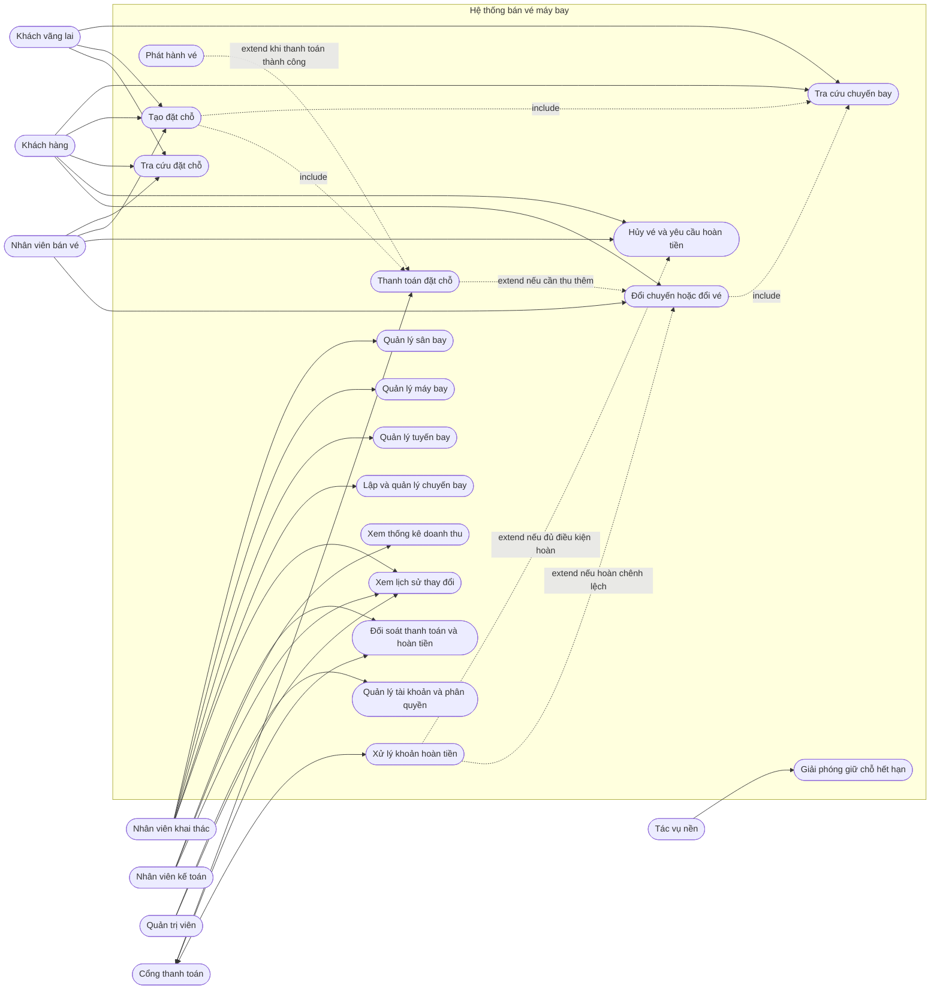

**Phạm vi quyền:** khách chỉ thao tác đặt chỗ của mình sau bước xác minh; nhân viên chỉ truy cập theo quyền được cấp và phải lưu dấu người thao tác; nhân viên khai thác không mặc nhiên được xem thông tin thanh toán nhạy cảm; kế toán không mặc nhiên được sửa lịch bay. Tài khoản quản trị cần phân quyền tách biệt với tài khoản vận hành.

### 12.2. ERD logic

ERD dưới đây làm rõ các quan hệ lưu trữ và các đối tượng nghiệp vụ cần có. `KhachHang` là người mua/người liên hệ; `HanhKhach` là từng người thực sự bay. Một booking có thể gồm nhiều hành khách. `ChiTietDatVe` biểu diễn một hành khách trên một chặng/chuyến bay, gắn với hạng vé, giá và điều kiện tại lúc bán. Tồn kho được giữ theo hạng vé; `GioCho` chỉ cần nếu sản phẩm cho khách chọn ghế cụ thể.

Ký hiệu: `PK` là khóa chính, `FK` là khóa ngoại, `UK` là duy nhất; `||` là đúng một, `o|` là không hoặc một, `o{` là không hoặc nhiều, `|{` là một hoặc nhiều.

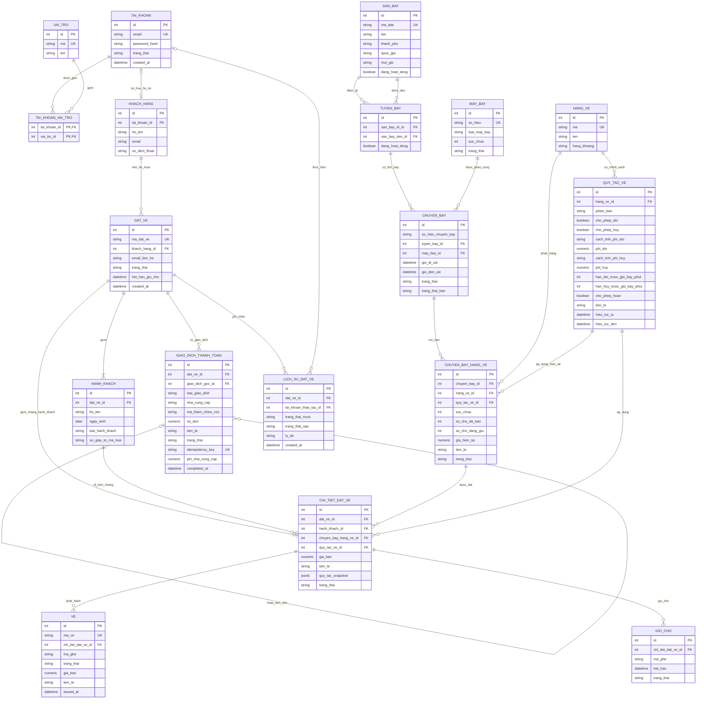

**Ràng buộc dữ liệu cần triển khai:**

- `SAN_BAY.ma_iata` duy nhất; sân bay đi và đến của tuyến bay phải khác nhau. Cặp tuyến có hướng `(san_bay_di_id, san_bay_den_id)` duy nhất nếu nghiệp vụ không cho tạo bản ghi tuyến trùng lặp.
- Thời gian trong DB lưu UTC (`timestamp with time zone` trong PostgreSQL); khi hiển thị chuyển theo múi giờ IANA của sân bay hoặc người dùng. Không lưu thời gian địa phương không kèm múi giờ.
- Số tiền dùng `numeric(18,2)` hoặc độ chính xác theo quy tắc tiền tệ đã chọn, không dùng `float`/`double`; mọi khoản có mã tiền tệ ISO 4217.
- `DAT_VE.ma_dat_ve`, `VE.ma_ve`, mã IATA, mã tham chiếu nhà cung cấp và `idempotency_key` có unique constraint theo phạm vi phù hợp. Mỗi cặp `CHUYEN_BAY_HANG_VE` chỉ có một bản ghi cho một chuyến và hạng vé; mã chuyến cần unique theo ngày/giờ khai thác.
- Tồn chỗ/bảng giá gắn với tổ hợp chuyến bay và hạng vé. Cập nhật `so_cho_da_ban`/`so_cho_dang_giu` trong transaction và bảo đảm tổng không vượt `suc_chua`. `GIO_CHO` chỉ cần khi có chọn ghế cụ thể; khi đó chỉ một booking được giữ/đã bán một ghế trên cùng chuyến bay tại một thời điểm, dùng unique index có điều kiện trên các trạng thái giữ/bán còn hiệu lực.
- `CHI_TIET_DAT_VE` là một hành khách trên một chặng/chuyến bay; đây là nơi chụp giá và phiên bản điều kiện vé lúc mua. `dat_ve_id` trên chi tiết phải khớp booking của hành khách (có thể dùng composite FK/constraint). Mỗi chi tiết chỉ được có tối đa một vé còn hiệu lực; vé đã đổi/hủy được lưu trạng thái và lịch sử thay vì xóa vật lý.
- `QUY_TAC_VE` cần phiên bản và thời gian hiệu lực; `CHI_TIET_DAT_VE.quy_tac_snapshot` lưu điều khoản áp dụng để thay đổi chính sách sau này không làm đổi quyền của vé đã bán.
- Giao dịch hoàn tiền liên kết giao dịch thanh toán gốc qua `giao_dich_goc_id`; phải chặn tổng số tiền hoàn vượt khoản đã thu thành công.
- Giấy tờ tùy thân là dữ liệu nhạy cảm: chỉ lưu trường thực sự cần thiết, mã hóa phù hợp, giới hạn quyền đọc và không ghi giá trị đầy đủ vào log.
- Thời hạn lưu thông tin cá nhân, lịch sử, dữ liệu kế toán và quy trình ẩn/xóa dữ liệu cần được xác nhận theo chính sách và quy định áp dụng.

### 12.3. Sequence diagram

#### 12.3.1. Tra cứu chuyến bay

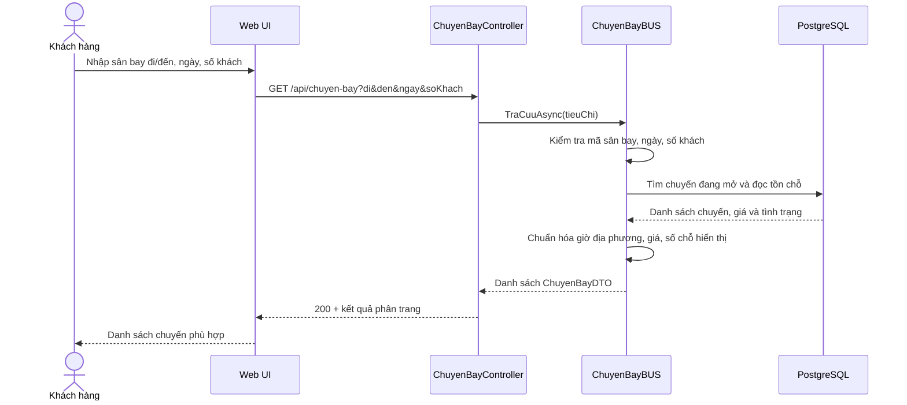

Tra cứu chỉ hiển thị trạng thái chỗ tham khảo. Tồn chỗ thực tế (và ghế cụ thể nếu có chọn ghế) chỉ được xác nhận ở bước giữ chỗ trong transaction để tránh bán vượt tồn khi nhiều người cùng chọn.

#### 12.3.2. Đặt chỗ, thanh toán và phát hành vé

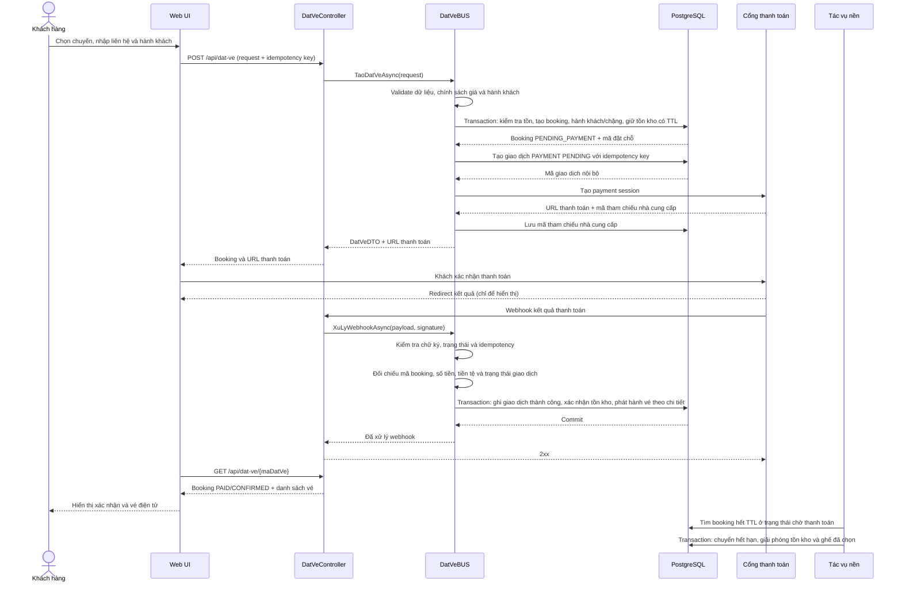

Không phát hành vé chỉ dựa trên redirect từ trình duyệt. Webhook phải xác thực chữ ký, đối chiếu booking/số tiền/tiền tệ, chống xử lý lặp bằng mã giao dịch/idempotency key và ghi nhận trước khi trả thành công. Nếu tạo payment session lỗi, booking tiếp tục chờ trong thời hạn giữ chỗ để có thể retry; nếu cổng thanh toán báo thành công sau khi giữ chỗ đã hết hạn, cần quy tắc đối soát và hoàn/đặt lại chỗ rõ ràng.

#### 12.3.3. Tra cứu đặt chỗ

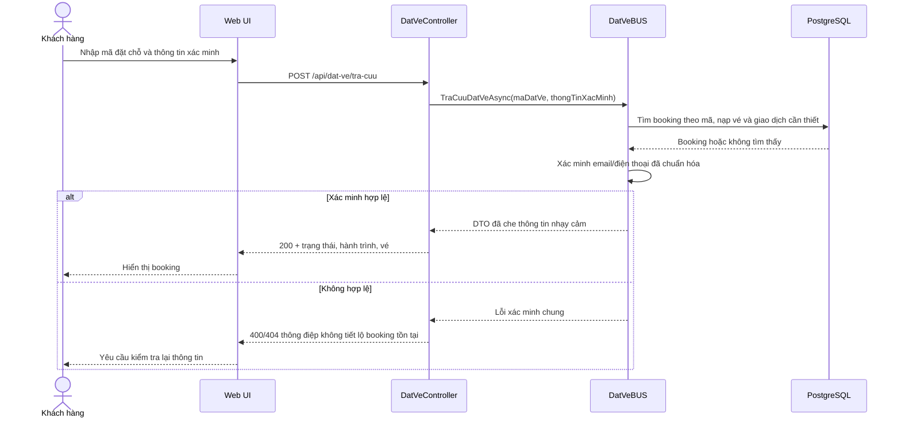

Thông tin xác minh không được ghi log dạng rõ. Cần giới hạn tần suất yêu cầu và che một phần email/số điện thoại trên giao diện.

#### 12.3.4. Hủy vé và hoàn tiền

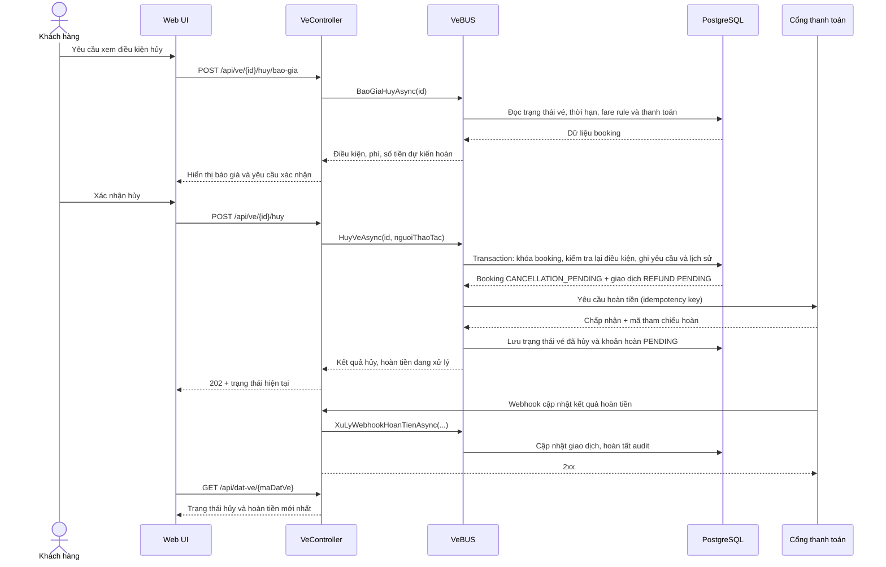

Hủy vé và hoàn tiền là hai trạng thái liên quan nhưng độc lập: vé có thể đã hủy trong khi khoản hoàn còn `PENDING`. Phí, hạn hủy, số tiền được hoàn và người có quyền duyệt phải lấy từ chính sách đã cấu hình; không mã hóa mặc định một mức phí trong sơ đồ.

#### 12.3.5. Đổi chuyến/đổi vé

```mermaid
sequenceDiagram
    actor KH as Khách hàng
    participant UI as Web UI
    participant API as VeController
    participant BUS as VeBUS
    participant DB as PostgreSQL
    participant PG as Cổng thanh toán

    KH->>UI: Chọn vé cần đổi và chuyến thay thế
    UI->>API: POST /api/ve/{id}/doi/bao-gia
    API->>BUS: BaoGiaDoiAsync(veId, chuyenBayMoi)
    BUS->>DB: Kiểm tra fare rule, tồn chỗ, giá mới, phí đổi
    DB-->>BUS: Dữ liệu để tính chênh lệch
    BUS-->>API: Báo giá và thời hạn hiệu lực
    API-->>UI: Chênh lệch thu thêm/hoàn và điều kiện
    KH->>UI: Xác nhận đổi
    UI->>API: POST /api/ve/{id}/doi
    API->>BUS: DoiVeAsync(request, idempotencyKey)
    BUS->>DB: Transaction: khóa booking/vé, kiểm tra lại, giữ chỗ chuyến mới
    DB-->>BUS: Giữ chỗ mới đã commit; vé cũ vẫn còn hiệu lực
    alt Cần thu thêm
        BUS->>PG: Tạo payment cho phần chênh lệch
        PG-->>BUS: Payment reference
        PG->>API: Webhook thành công
        API->>BUS: Xác nhận thanh toán đổi vé
    else Cần hoàn chênh lệch
        BUS->>PG: Tạo refund cho phần chênh lệch
        PG-->>BUS: Refund reference
        PG->>API: Webhook kết quả hoàn
        API->>BUS: Xác nhận refund
    else Không chênh lệch
        BUS->>BUS: Xác nhận đổi theo chính sách
    end
    BUS->>DB: Transaction: chuyển vé cũ sang REISSUED, xác nhận chỗ mới, phát hành vé mới, ghi lịch sử
    DB-->>BUS: Commit
    BUS-->>API: Booking và vé mới
    API-->>UI: Kết quả đổi chuyến
```

Việc giữ vé cũ trong khi chờ thanh toán/hoàn phải theo chính sách đổi vé. Mọi lần tính lại phải kiểm tra giá và tồn chỗ trong cùng luồng có kiểm soát đồng thời; cần cơ chế bù trừ nếu cổng thanh toán thành công nhưng cập nhật booking thất bại. Hoàn phần chênh lệch có thể bất đồng bộ; điều kiện phát hành vé mới khi khoản hoàn còn chờ phải được chốt, và mọi hoàn thất bại phải vào đối soát.

#### 12.3.6. Quản lý lịch chuyến bay

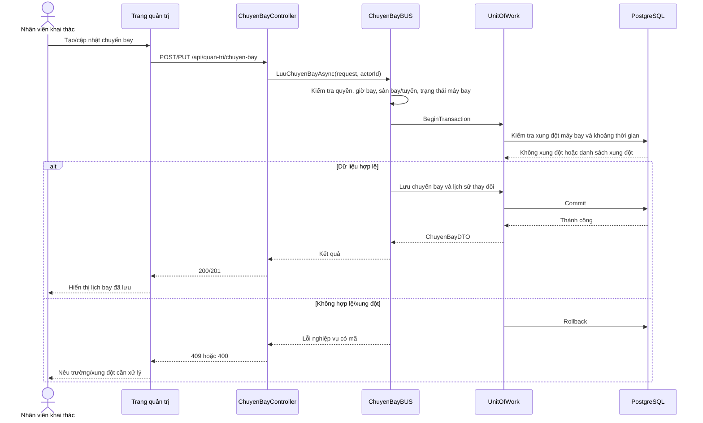

Không xóa chuyến bay đã có vé; thay đổi/hủy chuyến phải kích hoạt quy trình thông báo và xử lý vé bị ảnh hưởng. Kiểm tra xung đột phải tính thời gian quay đầu/đệm khai thác nếu nghiệp vụ yêu cầu.

#### 12.3.7. Quản lý sân bay, máy bay và tuyến bay

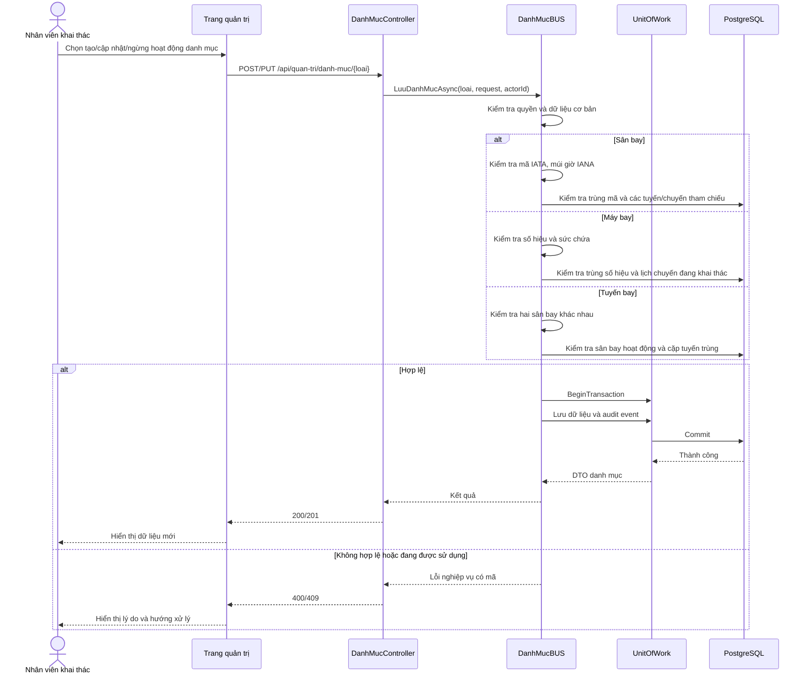

Danh mục đã được chuyến bay/booking tham chiếu thì ngừng hoạt động thay vì xóa cứng. Khi cần ngừng máy bay hoặc sân bay đang có lịch bán, hệ thống phải chặn thao tác trực tiếp hoặc chuyển qua quy trình điều chỉnh chuyến và xử lý khách bị ảnh hưởng.

#### 12.3.8. Thống kê doanh thu

```mermaid
sequenceDiagram
    actor KT as Nhân viên kế toán
    participant UI as Trang báo cáo
    participant API as ThongKeController
    participant BUS as ThongKeBUS
    participant DB as PostgreSQL

    KT->>UI: Chọn khoảng ngày, tiền tệ, nhóm báo cáo
    UI->>API: GET /api/thong-ke/doanh-thu?tuNgay&denNgay&nhomTheo
    API->>BUS: BaoCaoDoanhThuAsync(filter)
    BUS->>BUS: Kiểm tra quyền và khoảng thời gian
    BUS->>DB: Tổng hợp giao dịch PAYMENT thành công và REFUND thành công
    DB-->>BUS: Tổng thu, tổng hoàn, phí, số giao dịch theo nhóm
    BUS->>BUS: Tính doanh thu ròng; áp dụng quy ước ngày giao dịch/UTC
    BUS-->>API: BaoCaoDoanhThuDTO + thông tin bộ lọc
    API-->>UI: 200 + số liệu
    UI-->>KT: Bảng/biểu đồ và thời điểm kết xuất
```

Báo cáo phải nêu rõ ngày được nhóm theo ngày giao dịch hay ngày bay, cách quy đổi tiền tệ và trạng thái giao dịch được tính. Trong mô hình, doanh thu ròng giao dịch là tổng PAYMENT thành công trừ tổng REFUND thành công; phí nhà cung cấp được hiển thị riêng trừ khi chính sách kế toán quyết định tính vào một chỉ tiêu khác. Số liệu quản trị không tự động thay thế sổ kế toán/đối soát chính thức.

### 12.4. Activity diagram

#### 12.4.1. Từ tìm chuyến bay đến phát hành vé

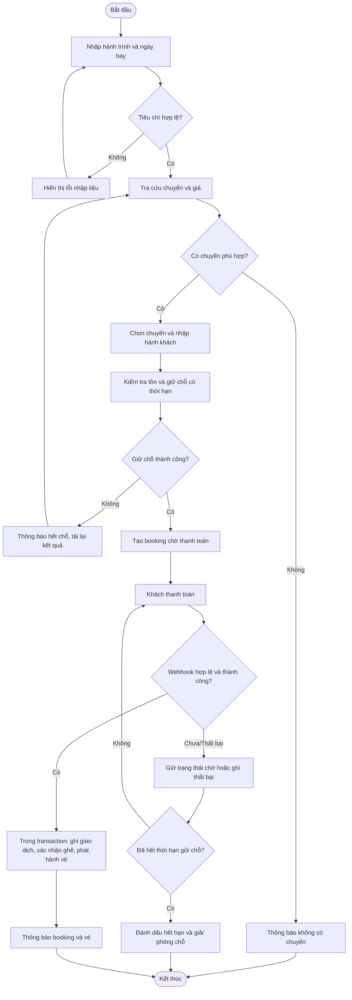

#### 12.4.2. Hủy và hoàn tiền

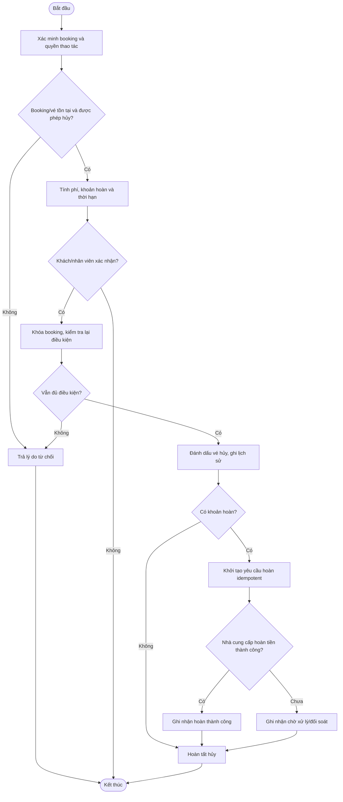

#### 12.4.3. Đổi chuyến

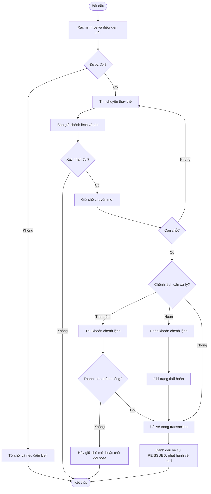

#### 12.4.4. Quản lý sân bay, máy bay, tuyến và lịch bay

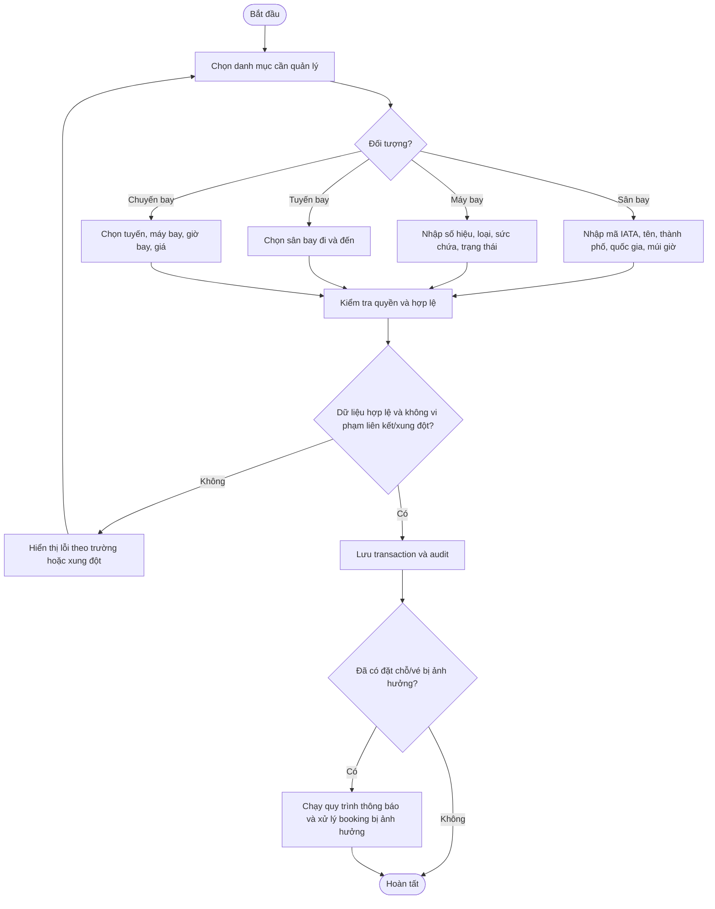

#### 12.4.5. Lập báo cáo doanh thu

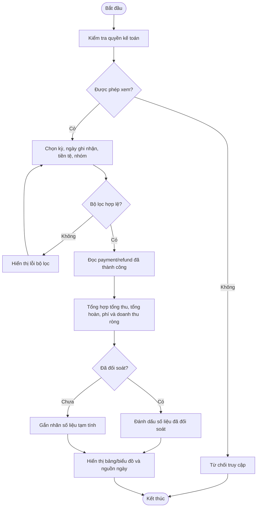

### 12.5. Class diagram mục tiêu

Sơ đồ thể hiện ranh giới domain, DTO, BUS, DAL, Web và cổng thanh toán. `DanhMucBUS` là service mục tiêu đề xuất cho UC-07–09; có thể tách thành `SanBayBUS`, `MayBayBUS`, `TuyenBayBUS` khi muốn mỗi service phụ trách một aggregate. DTO là hợp đồng dữ liệu vào/ra, không dùng entity EF trực tiếp làm response. `UnitOfWork`/transaction được đưa vào mô hình vì các bước giữ chỗ, phát hành vé, đổi/hủy cần cập nhật nhiều bản ghi nhất quán; nếu code hiện tại dùng cách khác thì cần bảo đảm cùng bất biến nghiệp vụ.

```mermaid
classDiagram
    direction LR

    namespace Domain {
        class SanBay {
            +int Id
            +string MaIata
            +string Ten
            +string MuiGio
            +bool DangHoatDong
        }
        class TaiKhoan {
            +int Id
            +string Email
            +string PasswordHash
            +string TrangThai
        }
        class VaiTro {
            +int Id
            +string Ma
            +string Ten
        }
        class TuyenBay {
            +int Id
            +int SanBayDiId
            +int SanBayDenId
            +bool DangHoatDong
            +KiemTraHopLe()
        }
        class MayBay {
            +int Id
            +string SoHieu
            +int SucChua
            +string TrangThai
        }
        class ChuyenBay {
            +int Id
            +string SoHieuChuyenBay
            +DateTimeOffset GioDiUtc
            +DateTimeOffset GioDenUtc
            +string TrangThai
            +KiemTraCoTheDatVe()
        }
        class HangVe {
            +int Id
            +string Ma
            +string Ten
            +string HangKhoang
        }
        class ChuyenBayHangVe {
            +int Id
            +int QuyTacVeId
            +int SucChua
            +int SoChoDaBan
            +int SoChoDangGiu
            +decimal GiaHienTai
            +string TienTe
            +string TrangThai
        }
        class QuyTacVe {
            +int Id
            +string PhienBan
            +bool ChoPhepDoi
            +bool ChoPhepHuy
            +string CachTinhPhiDoi
            +decimal PhiDoi
            +string CachTinhPhiHuy
            +decimal PhiHuy
            +int HanDoiTruocGioBayPhut
            +int HanHuyTruocGioBayPhut
            +bool ChoPhepHoan
        }
        class KhachHang {
            +int Id
            +string HoTen
            +string Email
            +string SoDienThoai
        }
        class DatVe {
            +int Id
            +string MaDatVe
            +string TrangThai
            +DateTimeOffset HetHanGiuCho
            +XacNhanThanhToan()
            +Huy()
        }
        class TaiKhoanVaiTro {
            +int TaiKhoanId
            +int VaiTroId
        }
        class HanhKhach {
            +int Id
            +string HoTen
            +DateOnly NgaySinh
            +string LoaiHanhKhach
        }
        class ChiTietDatVe {
            +int Id
            +decimal GiaBan
            +string TienTe
            +string QuyTacSnapshotJson
            +string TrangThai
        }
        class GioCho {
            +int Id
            +string MaGhe
            +DateTimeOffset HetHan
            +string TrangThai
        }
        class Ve {
            +int Id
            +string MaVe
            +string TrangThai
            +decimal GiaBan
            +Huy()
            +Doi()
        }
        class GiaoDichThanhToan {
            +int Id
            +string LoaiGiaoDich
            +decimal SoTien
            +string TienTe
            +string TrangThai
            +string IdempotencyKey
            +decimal PhiNhaCungCap
        }
        class LichSuDatVe {
            +int Id
            +string TrangThaiTruoc
            +string TrangThaiSau
            +string LyDo
            +DateTimeOffset CreatedAt
        }
    }

    namespace DTO {
        class TaoDatVeRequestDTO {
            +int ChuyenBayId
            +int HangVeId
            +string TenLienHe
            +string EmailLienHe
            +string SoDienThoaiLienHe
            +List HanhKhachDTO
            +string IdempotencyKey
        }
        class DatVeDTO {
            +string MaDatVe
            +string TrangThai
            +DateTimeOffset HetHanGiuCho
            +decimal TongTien
            +string TienTe
            +List VeDTO
        }
        class ChuyenBayDTO {
            +int Id
            +string SanBayDi
            +string SanBayDen
            +string HangVe
            +DateTimeOffset GioDi
            +DateTimeOffset GioDen
            +decimal GiaTu
            +string TienTe
        }
        class SanBayDTO {
            +int Id
            +string MaIata
            +string Ten
            +string MuiGio
            +string TrangThai
        }
        class MayBayDTO {
            +int Id
            +string SoHieu
            +int SucChua
            +string TrangThai
        }
        class TuyenBayDTO {
            +int Id
            +int SanBayDiId
            +int SanBayDenId
            +string TrangThai
        }
        class VeDTO {
            +string MaVe
            +string TenHanhKhach
            +string ChuyenBay
            +string TrangThai
            +decimal GiaBan
        }
        class ChiTietDatVeDTO {
            +string TenHanhKhach
            +string ChuyenBay
            +string HangVe
            +decimal GiaBan
            +string TrangThaiVe
        }
        class GiaoDichThanhToanDTO {
            +string MaGiaoDich
            +string LoaiGiaoDich
            +decimal SoTien
            +string TienTe
            +string TrangThai
        }
        class BaoGiaDoiHuyDTO {
            +decimal Phi
            +decimal ChenhLech
            +decimal SoTienHoan
            +string TienTe
            +DateTimeOffset HetHanBaoGia
        }
        class TaiKhoanDTO {
            +int Id
            +string Email
            +List VaiTro
        }
        class BaoCaoDoanhThuDTO {
            +DateOnly TuNgay
            +DateOnly DenNgay
            +decimal TongThu
            +decimal TongHoan
            +decimal DoanhThuRong
            +string TienTe
        }
    }

    namespace BUS {
        class DanhMucBUS {
            +LuuSanBayAsync(request)
            +LuuMayBayAsync(request)
            +LuuTuyenBayAsync(request)
        }
        class ChuyenBayBUS {
            +TraCuuAsync(filter)
            +LuuChuyenBayAsync(request)
        }
        class DatVeBUS {
            +TaoDatVeAsync(request)
            +TraCuuDatVeAsync(maDatVe, proof)
            +XuLyWebhookAsync(payload) Task
        }
        class VeBUS {
            +TraCuuVeAsync(maVe)
            +BaoGiaHuyAsync(request)
            +HuyVeAsync(request)
            +BaoGiaDoiAsync(request)
            +DoiVeAsync(request)
            +XuLyWebhookHoanTienAsync(payload)
        }
        class TaiKhoanBUS {
            +DangNhapAsync(request)
            +QuanLyVaiTroAsync(request)
        }
        class ThongKeBUS {
            +BaoCaoDoanhThuAsync(filter)
        }
    }

    namespace DAL {
        class AppDbContext
        class IUnitOfWork {
            <<interface>>
            +BeginTransactionAsync()
            +CommitAsync()
            +RollbackAsync()
        }
        class IRepository {
            <<interface>>
            +GetByIdAsync(id)
            +AddAsync(entity)
            +Update(entity)
        }
        class EfRepository {
            +GetByIdAsync(id)
            +AddAsync(entity)
            +Update(entity)
        }
        class IPaymentGateway {
            <<interface>>
            +CreatePaymentAsync(request)
            +RefundAsync(request)
            +VerifyWebhook(payload, signature)
        }
        class PaymentGatewayAdapter
    }

    namespace Web {
        class DanhMucController
        class ChuyenBayController
        class DatVeController
        class VeController
        class ThongKeController
        class TaiKhoanController
    }

    TaiKhoan "1" -- "0..*" TaiKhoanVaiTro : duoc gan
    VaiTro "1" -- "0..*" TaiKhoanVaiTro : gom
    TaiKhoan "0..1" -- "0..1" KhachHang : ho so
    SanBay "1" <-- "0..*" TuyenBay : san bay di/den
    TuyenBay "1" <-- "0..*" ChuyenBay : lich khai thac
    MayBay "1" <-- "0..*" ChuyenBay : phan cong
    ChuyenBay "1" *-- "0..*" ChuyenBayHangVe : hang ve/mo ban
    HangVe "1" <-- "0..*" ChuyenBayHangVe : phan hang
    HangVe "1" <-- "0..*" QuyTacVe : chinh sach
    QuyTacVe "1" <-- "0..*" ChuyenBayHangVe : dang ap dung
    KhachHang "0..1" <-- "0..*" DatVe : nguoi lien he
    DatVe "1" *-- "1..*" HanhKhach : danh sach
    DatVe "1" *-- "1..*" ChiTietDatVe : hanh khach tren tung chang
    HanhKhach "1" <-- "0..*" ChiTietDatVe : di tren chang
    ChuyenBayHangVe "1" <-- "0..*" ChiTietDatVe : duoc dat
    QuyTacVe "1" <-- "0..*" ChiTietDatVe : ap dung
    ChiTietDatVe "1" *-- "0..*" Ve : cac lan phat hanh
    ChiTietDatVe "1" *-- "0..*" GioCho : giu cho
    DatVe "1" *-- "0..*" GiaoDichThanhToan : payment/refund
    DatVe "1" *-- "0..*" LichSuDatVe : audit

    DanhMucBUS ..> IRepository : doc/ghi
    ChuyenBayBUS ..> IRepository : doc/ghi
    DatVeBUS ..> IRepository : doc/ghi
    VeBUS ..> IRepository : doc/ghi
    TaiKhoanBUS ..> IRepository : doc/ghi
    ThongKeBUS ..> IRepository : truy van tong hop
    ChuyenBayBUS ..> ChuyenBayDTO : tao
    DanhMucBUS ..> SanBayDTO : tao
    DanhMucBUS ..> MayBayDTO : tao
    DanhMucBUS ..> TuyenBayDTO : tao
    DatVeBUS ..> TaoDatVeRequestDTO : nhan
    DatVeBUS ..> DatVeDTO : tra
    DatVeBUS ..> IPaymentGateway : thu tien
    DatVeBUS ..> GiaoDichThanhToanDTO : tra
    VeBUS ..> ChiTietDatVeDTO : tra
    VeBUS ..> BaoGiaDoiHuyDTO : tra
    VeBUS ..> IPaymentGateway : hoan tien/doi ve
    TaiKhoanBUS ..> TaiKhoanDTO : tra
    ThongKeBUS ..> BaoCaoDoanhThuDTO : tao
    EfRepository ..|> IRepository : implements
    EfRepository ..> AppDbContext : EF Core
    IUnitOfWork ..> AppDbContext : transaction
    PaymentGatewayAdapter ..|> IPaymentGateway : implements
    DanhMucController ..> DanhMucBUS : goi
    ChuyenBayController ..> ChuyenBayBUS : goi
    DatVeController ..> DatVeBUS : goi
    VeController ..> VeBUS : goi
    ThongKeController ..> ThongKeBUS : goi
    TaiKhoanController ..> TaiKhoanBUS : goi
```

**Trách nhiệm theo lớp:**

- **Web/Controller:** xác thực request, phân quyền, gọi BUS, ánh xạ lỗi nghiệp vụ sang HTTP; không tự tính giá/điều kiện hủy.
- **BUS:** điều phối use case, kiểm tra quy tắc nghiệp vụ, transaction và idempotency; không trả entity EF ra ngoài.
- **DAL/Repository:** truy vấn và lưu dữ liệu; cấu hình index, khóa ngoại và transaction PostgreSQL.
- **Domain:** trạng thái và bất biến cốt lõi của đặt chỗ, vé, chuyến bay; không phụ thuộc MVC/EF khi có thể giữ thuần nghiệp vụ.
- **DTO:** tách request/response; request không cho client tự quyết định giá cuối, trạng thái booking, quyền hạn hay kết quả thanh toán.
- **IPaymentGateway/PaymentGatewayAdapter:** adapter với nhà cung cấp; xác thực webhook và ánh xạ mã trạng thái ngoài vào trạng thái nội bộ.

### 12.6. Traceability và tiêu chí nghiệm thu sơ đồ

| Nhóm chức năng               | Use Case        | Sequence      | Activity | Dữ liệu chính                                                                      |
| ---------------------------- | --------------- | ------------- | -------- | ---------------------------------------------------------------------------------- |
| Tra cứu chuyến               | UC-01           | 12.3.1        | 12.4.1   | `SAN_BAY`, `TUYEN_BAY`, `CHUYEN_BAY`, `MAY_BAY`, `CHUYEN_BAY_HANG_VE`              |
| Đặt chỗ, thanh toán, xuất vé | UC-02, UC-03    | 12.3.2        | 12.4.1   | `DAT_VE`, `HANH_KHACH`, `CHI_TIET_DAT_VE`, `GIO_CHO`, `VE`, `GIAO_DICH_THANH_TOAN` |
| Tra cứu booking              | UC-04           | 12.3.3        | —        | `DAT_VE`, `VE`                                                                     |
| Hủy và hoàn tiền             | UC-05, UC-11    | 12.3.4        | 12.4.2   | `VE`, `GIAO_DICH_THANH_TOAN`, `LICH_SU_DAT_VE`                                     |
| Đổi chuyến                   | UC-06           | 12.3.5        | 12.4.3   | `VE`, `CHI_TIET_DAT_VE`, `CHUYEN_BAY_HANG_VE`, `GIO_CHO`, `GIAO_DICH_THANH_TOAN`   |
| Quản trị khai thác           | UC-07 đến UC-10 | 12.3.6–12.3.7 | 12.4.4   | `SAN_BAY`, `MAY_BAY`, `TUYEN_BAY`, `CHUYEN_BAY`                                    |
| Doanh thu                    | UC-12           | 12.3.8        | 12.4.5   | `GIAO_DICH_THANH_TOAN`                                                             |

Trước khi nghiệm thu triển khai, mỗi use case cần được nối với endpoint, quyền, trạng thái đầu/cuối, mã lỗi, audit event và test case tương ứng. Những quyết định đang mở ở mục 11 (đổi/hủy, chính sách giá, thanh toán, khứ hồi/nối chuyến và định nghĩa doanh thu) có thể làm thay đổi sơ đồ và schema, nên phải cập nhật tài liệu cùng migration khi được chốt.
